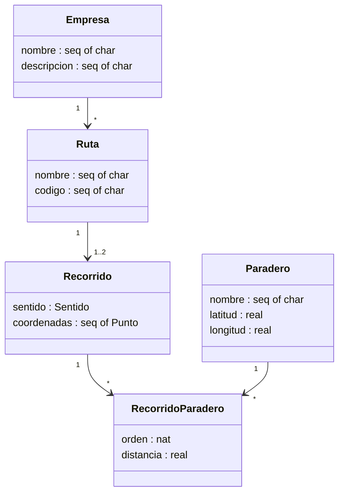

# Ejercicio Práctico 3 — Secuencias, Conjuntos, Diagrama de Clases y Tipo `map`

**Proyecto:** Sistema de Planificación de Viajes en Transporte Público

## 1. Uso de secuencia (Seq) y conjunto (Set)

El proyecto hace uso de **ambos** tipos: secuencia y conjunto.

- **Secuencia (`seq`)**: el campo `coordenadas : seq of Punto`. Modela la propiedad de *orden* del trayecto: el orden de los puntos define el recorrido y es posible que un punto se repita (por ejemplo, en una parada). Por ello se elige secuencia y no conjunto.
- **Conjunto (`set`)**: colecciones como `paraderos : set of ParaderoId` o `empresas : set of Empresa`. Modelan catálogos en los que el *orden no importa* y *no debe haber duplicados*, por lo que el conjunto es la representación natural.

## 2. Diagrama de clases inicial

El diagrama incluye las clases `Empresa`, `Ruta`, `Recorrido`, `Paradero` y `RecorridoParadero`, junto con sus asociaciones y cardinalidades.



## 3. Tipo map para relacionar las clases

El tipo `map` relaciona un dominio con un rango. Para vincular cada ruta con sus recorridos se define:

```
recorridosPorRuta : map Ruta to set of Recorrido
```

## 4. Invariante asociada

La invariante asociada al mapa establece dos propiedades: (1) cada ruta tiene a lo sumo dos recorridos (IDA y VUELTA), y (2) cada recorrido almacenado en el mapa hace referencia a la ruta que lo contiene.

```
inv recorridosPorRuta ==
  (forall r in set dom recorridosPorRuta &
     card recorridosPorRuta(r) <= 2)
  and
  (forall r in set dom recorridosPorRuta &
     forall rec in set recorridosPorRuta(r) &
       rec.ruta = r);
```
