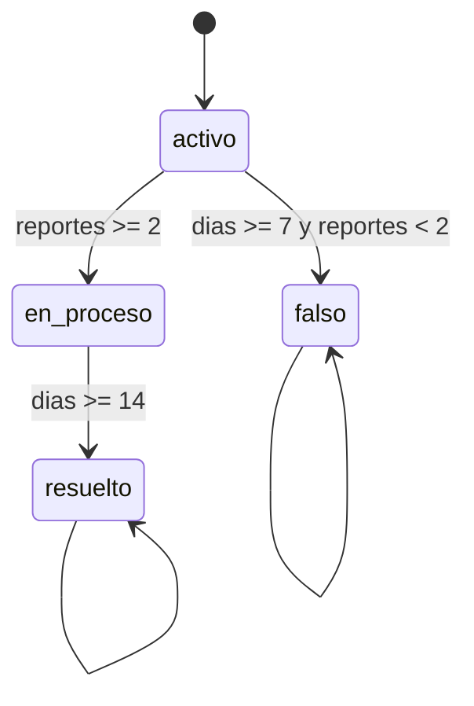

# Anexo — Sistema de Transición de Estados para Incidencias del Foro

**Proyecto:** Sistema de Planificación de Viajes en Transporte Público (aqpTracker)

Este anexo conserva el modelo de transición de estados del ciclo de vida de una incidencia como ejemplo complementario del proyecto. El modelo principal del Ejercicio Práctico 4 se enfoca en la búsqueda de rutas.

## Objetivo

Modelar como sistema de transición de estados el ciclo de vida de una incidencia urbana del foro del proyecto, identificando estados, variables, condiciones de transición y actualizaciones de valores, y verificando un requerimiento mediante los operadores temporales `G` y `F` de NuSMV.

## 1. ¿Qué es un sistema de transición de estados?

Un sistema de transición de estados (STS, por sus siglas en inglés) es una estructura formal:

```
M = (S, S0, →, AP, L)
```

donde `S` es un conjunto finito de estados, `S0 ⊆ S` son los estados iniciales, `→ ⊆ S × S` es la relación de transición, `AP` es un conjunto de proposiciones atómicas y `L : S → 2^AP` indica qué proposiciones son verdaderas en cada estado.

En NuSMV el sistema se describe con variables de dominio finito, asignaciones iniciales (`init`) y asignaciones de siguiente estado (`next`). Las propiedades se escriben en LTL:

- `G φ` ("globalmente φ"): φ se cumple en todos los estados de todos los caminos. Se usa para propiedades de seguridad o invariantes.
- `F φ` ("eventualmente φ"): φ se cumple en algún estado futuro de todos los caminos. Se usa para propiedades de vivacidad o alcanzabilidad.

## 2. Descripción del modelo

Se modela el ciclo de vida de una incidencia del foro. Una incidencia se publica en estado `activo`. Si la comunidad la respalda con al menos dos reportes, pasa a `en_proceso`; si es atendida, pasa a `resuelto` al cumplirse 14 días. Si no recibe al menos dos reportes en 7 días, se descarta como `falso`. Los estados `resuelto` y `falso` son terminales.

Las variables `reportes`, `dias` y `notificado` registran el respaldo ciudadano, el tiempo transcurrido y la notificación al autor. La actualización no determinista de `reportes` representa la incertidumbre sobre cuántos ciudadanos confirmarán la incidencia en cada día. El modelo es una abstracción de las reglas de negocio del foro: no representa el texto ni las imágenes de la incidencia, sino las condiciones que determinan su estado.

Se eligió este componente porque el proyecto ya define los estados `Activo`, `En proceso`, `Resuelto` y `Falso` para las incidencias, y porque permite ilustrar de forma clara las variables, las guardas y las actualizaciones de valores solicitadas en el ejercicio.

## 3. Estados, variables y estado inicial

### Estados

| Estado | Significado |
|--------|-------------|
| `activo` | Incidencia publicada, pendiente de validación |
| `en_proceso` | Incidencia validada por la comunidad y en atención |
| `resuelto` | Incidencia atendida y cerrada |
| `falso` | Incidencia descartada por falta de respaldo |

### Variables

| Variable | Dominio | Descripción |
|----------|---------|-------------|
| `estado` | `{activo, en_proceso, resuelto, falso}` | Estado actual de la incidencia |
| `reportes` | `0..5` | Número de confirmaciones ciudadanas |
| `dias` | `0..30` | Días transcurridos desde la publicación |
| `notificado` | `boolean` | Indica si el autor ya fue notificado |

Estado inicial: `estado = activo`, `reportes = 0`, `dias = 0`, `notificado = FALSE`.

### Diagrama de estados



## 4. Condiciones de transición y actualizaciones

| Estado actual | Condición | Estado siguiente | Actualización |
|---------------|-----------|------------------|---------------|
| `activo` | `reportes >= 2` | `en_proceso` | `notificado := TRUE` |
| `activo` | `dias >= 7 & reportes < 2` | `falso` | `notificado := TRUE` |
| `en_proceso` | `dias >= 14` | `resuelto` | `notificado := TRUE` |
| `resuelto` o `falso` | — | mismo estado | sin cambios |

Actualizaciones de las variables en cada transición:

| Variable | Actualización |
|----------|---------------|
| `reportes` | Si `estado = activo & reportes < 5 & dias < 7`, entonces `reportes` o `reportes + 1`; en otro caso, permanece. |
| `dias` | Si `estado` es `activo` o `en_proceso` y `dias < 30`, entonces `dias + 1`; en otro caso, permanece. |
| `notificado` | Pasa a `TRUE` al salir de `activo` o al pasar de `en_proceso` a `resuelto`; en otro caso, permanece. |

La condición `dias < 7` en la actualización de `reportes` evita que una incidencia que será descartada incremente su contador en el mismo paso, lo que preserva la invariante `estado = falso -> reportes < 2`.

## 5. Código NuSMV

El código completo del modelo se presenta en la Figura 1.

```smv
MODULE main
VAR
  estado     : {activo, en_proceso, resuelto, falso};
  reportes   : 0..5;
  dias       : 0..30;
  notificado : boolean;

ASSIGN
  init(estado)     := activo;
  init(reportes)   := 0;
  init(dias)       := 0;
  init(notificado) := FALSE;

  next(estado) := case
    estado = activo & reportes >= 2            : en_proceso;
    estado = activo & dias >= 7 & reportes < 2 : falso;
    estado = en_proceso & dias >= 14           : resuelto;
    TRUE                                       : estado;
  esac;

  next(reportes) := case
    estado = activo & reportes < 5 & dias < 7 : {reportes, reportes + 1};
    TRUE                                      : reportes;
  esac;

  next(dias) := case
    (estado = activo | estado = en_proceso) & dias < 30 : dias + 1;
    TRUE                                                : dias;
  esac;

  next(notificado) := case
    !notificado & estado = activo & reportes >= 2            : TRUE;
    !notificado & estado = activo & dias >= 7 & reportes < 2 : TRUE;
    !notificado & estado = en_proceso & dias >= 14           : TRUE;
    TRUE                                                     : notificado;
  esac;

DEFINE
  terminal := (estado = resuelto | estado = falso);

LTLSPEC G (estado = resuelto -> X estado = resuelto);
LTLSPEC G (estado = falso -> X estado = falso);
LTLSPEC G (estado != activo -> notificado);
LTLSPEC G (estado = en_proceso -> reportes >= 2);
LTLSPEC G (estado = falso -> reportes < 2);
LTLSPEC G ((estado = activo & reportes >= 2) -> F estado = en_proceso);
LTLSPEC F terminal;
```

**Figura 1.** Código NuSMV del sistema de transición de estados de una incidencia.

La definición `terminal` es un alias que abrevia la condición `estado = resuelto | estado = falso`; se usa para simplificar la lectura de la propiedad R3.

## 6. Requerimiento verificado con G y F

### Requerimiento principal

**R2:** "Toda incidencia activa que recibe al menos dos reportes eventualmente pasa a `en_proceso`."

Fórmula LTL:

```smv
LTLSPEC G ((estado = activo & reportes >= 2) -> F estado = en_proceso);
```

La fórmula combina `G` y `F`: `G` exige que la implicación se cumpla en todos los estados alcanzables, y `F` exige que, cuando la condición se cumple, exista un estado futuro en el que la incidencia esté en `en_proceso`. La propiedad se cumple porque `reportes` nunca disminuye y, cuando vale al menos 2, la primera regla de transición conduce a `en_proceso` en el siguiente paso. Además, la condición antecedente es alcanzable en alguna ejecución (`SPEC EF (estado = activo & reportes >= 2)` devuelve `true`), por lo que la propiedad no es vacua.

### Requerimientos complementarios

| ID | Requerimiento | Fórmula LTL | Tipo |
|----|---------------|-------------|------|
| R1 | Toda incidencia que no está activa ya fue notificada | `G (estado != activo -> notificado)` | Seguridad |
| R3 | Toda incidencia alcanza un estado terminal | `F terminal` | Vivacidad |
| R4 | Una incidencia resuelta no vuelve a otro estado | `G (estado = resuelto -> X estado = resuelto)` | Seguridad |
| R5 | Una incidencia falsa no vuelve a otro estado | `G (estado = falso -> X estado = falso)` | Seguridad |
| R6 | Una incidencia en proceso tiene al menos dos reportes | `G (estado = en_proceso -> reportes >= 2)` | Seguridad |
| R7 | Una incidencia falsa tiene menos de dos reportes | `G (estado = falso -> reportes < 2)` | Seguridad |

## 7. Ejecución y resultados

Ejecutar:

```bash
NuSMV incidencias.smv
```

Salida esperada:

```text
-- specification  G (estado = resuelto ->  X estado = resuelto)  is true
-- specification  G (estado = falso ->  X estado = falso)  is true
-- specification  G (estado = en_proceso -> reportes >= 2)  is true
-- specification  G (estado = falso -> reportes < 2)  is true
-- specification  G ((estado = activo & reportes >= 2) ->  F estado = en_proceso)  is true
-- specification  F terminal  is true
-- specification  G (estado != activo -> notificado)  is true
```

Todas las propiedades se verifican. Esto significa que, para todas las ejecuciones posibles del modelo, se cumplen las invariantes y las propiedades de vivacidad indicadas.

### Prueba adicional: una propiedad que no se cumple

Si se agrega la fórmula:

```smv
LTLSPEC G (estado = activo -> F estado = resuelto);
```

NuSMV responde `is false` y devuelve un contraejemplo: una ejecución en la que `reportes` permanece en 0 y, al llegar a `dias = 7`, la incidencia pasa a `falso`. En esa ejecución nunca se alcanza `resuelto`. Esto no es un error del modelo: refleja que no toda incidencia publicada es necesariamente resuelta; las que no reciben respaldo se descartan. El requerimiento correcto es R3 (alcanzar un estado terminal), no "toda incidencia se resuelve".

Traza resumida del contraejemplo:

```text
Estado 1.1: estado = activo,    reportes = 0, dias = 0, notificado = FALSE
...
Estado 1.8: estado = activo,    reportes = 0, dias = 7
Estado 1.9: estado = falso,     reportes = 0, dias = 8, notificado = TRUE
```

## 8. Relación con el proyecto

| Elemento NuSMV | Elemento del proyecto |
|----------------|-----------------------|
| `activo`, `en_proceso`, `resuelto`, `falso` | Registros del modelo `Estado` del foro |
| `reportes` | Confirmaciones registradas en `Reporte` |
| `dias` | Diferencia entre `fecha_creacion` y la fecha actual |
| `notificado` | Notificación al autor (`Notificacion`) |

La implementación en Django/React puede reflejar este modelo con una máquina de estados en el servicio de incidencias: las guardas de NuSMV se traducen en validaciones antes de cambiar `Incidencia.estado`, y las actualizaciones en el incremento de contadores y la creación de notificaciones. El modelo formal sirve como especificación previa y como base para pruebas de transición.

El mismo patrón puede aplicarse al subsistema de búsqueda de rutas, con estados `esperando`, `buscando`, `con_ruta` y `sin_ruta`, y una variable `rutas_encontradas`. En ese caso, una propiedad de seguridad útil sería `G (estado = con_ruta -> rutas_encontradas > 0)`, que garantiza que no se muestre una ruta cuando la búsqueda no produjo resultados.

## 9. Conclusión

Se definió un sistema de transición de estados con cuatro estados, cuatro variables, condiciones de transición y actualizaciones de valores. El modelo se codificó en NuSMV y se verificaron propiedades de seguridad y vivacidad con `G` y `F`. La propiedad principal garantiza que una incidencia con suficiente respaldo ciudadano eventualmente pasa a `en_proceso`; las propiedades complementarias garantizan la terminalidad de los estados finales y la notificación al autor. El contraejemplo de la propiedad "toda incidencia se resuelve" muestra que el modelo distingue correctamente entre incidencias resueltas y descartadas.

## 10. Cómo ejecutar

1. Descargar NuSMV desde <https://nusmv.fbk.eu/downloads.html>.
2. Guardar el código en `incidencias.smv`.
3. Ejecutar `NuSMV incidencias.smv`.
4. Opcionalmente, abrir la consola interactiva con `NuSMV -int incidencias.smv` y ejecutar `check_ltlspec`.
