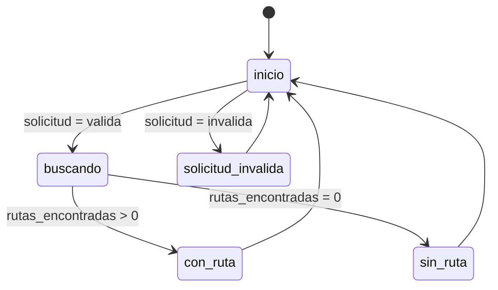

# Ejercicio Práctico 4 — Sistema de Transición de Estados en NuSMV: Búsqueda de Rutas

**Proyecto:** Sistema de Planificación de Viajes en Transporte Público (aqpTracker)

## Objetivo

Modelar como sistema de transición de estados el ciclo de una solicitud de búsqueda de rutas de transporte público, identificando estados, variables, condiciones de transición y actualizaciones de valores, y verificando un requerimiento mediante los operadores temporales `G` y `F` de NuSMV.

## 1. ¿Qué es un sistema de transición de estados?

Un sistema de transición de estados (STS, por sus siglas en inglés) es una estructura formal:

```
M = (S, S0, →, AP, L)
```

donde `S` es un conjunto finito de estados, `S0 ⊆ S` son los estados iniciales, `→ ⊆ S × S` es la relación de transición, `AP` es un conjunto de proposiciones atómicas y `L : S → 2^AP` indica qué proposiciones son verdaderas en cada estado.

En NuSMV el sistema se describe con variables de dominio finito, asignaciones iniciales (`init`) y asignaciones de siguiente estado (`next`). Las propiedades se escriben en LTL:

- `G φ` ("globalmente φ"): φ se cumple en todos los estados de todos los caminos. Se usa para propiedades de seguridad o invariantes.
- `F φ` ("eventualmente φ"): φ se cumple en algún estado futuro de todos los caminos. Se usa para propiedades de vivacidad o alcanzabilidad.

### 1.1 Contexto metodológico

La traducción de modelos de estado a verificadores simbólicos se ha aplicado en diversos dominios. Kochaleema y Santhosh Kumar (2022) traducen Statecharts UML a sistemas de transición etiquetados y verifican propiedades CTL/LTL; Hlaoui y Ayari (2025) compilan modelos de proceso correctos por construcción a NuSMV; y Xavier et al. (2024) sintetizan máquinas de estado desde registros de eventos y las verifican con NuSMV. Este trabajo adopta el mismo enfoque: un modelo abstracto de estados, propiedades LTL y verificación con NuSMV.

## 2. Descripción del modelo

Se modela el ciclo de una solicitud de búsqueda de rutas. El sistema parte en `inicio`, esperando una solicitud. Si la solicitud es válida, pasa a `buscando`; si es inválida, pasa a `solicitud_invalida`. Cuando la búsqueda termina, el sistema pasa a `con_ruta` si se encontró al menos una ruta, o a `sin_ruta` si no se encontró ninguna. Los estados `con_ruta`, `sin_ruta` y `solicitud_invalida` son transitorios: después de mostrar el resultado, el sistema vuelve a `inicio`.

La variable `solicitud` representa la entrada del usuario y se actualiza de forma no determinista, modelando que en cada paso puede llegar una solicitud válida, una inválida o ninguna. La variable `rutas_encontradas` se asigna al iniciar una búsqueda válida y determina el resultado. La variable `consultas` cuenta las solicitudes válidas procesadas.

El modelo es una abstracción del flujo de los endpoints `buscar_rutas_view` y `buscar_rutas_combinadas_view`: el backend actual es stateless (responde a una petición POST), pero la interfaz de usuario sí atraviesa estos estados. El modelo sirve como especificación del comportamiento esperado y como base para una futura máquina de estados en el frontend o en un servicio de búsqueda. La distinción entre búsqueda directa y combinada se deja al algoritmo (VDM++); la máquina de estados modela el ciclo común de la solicitud.

## 3. Estados, variables y estado inicial

### Estados

| Estado | Significado |
|--------|-------------|
| `inicio` | Esperando una solicitud de búsqueda |
| `buscando` | Solicitud válida en proceso; abstrae búsqueda directa y combinada |
| `con_ruta` | La búsqueda encontró al menos una ruta |
| `sin_ruta` | La búsqueda no encontró rutas |
| `solicitud_invalida` | La solicitud es inválida |

### Variables

| Variable | Dominio | Descripción |
|----------|---------|-------------|
| `estado` | `{inicio, buscando, con_ruta, sin_ruta, solicitud_invalida}` | Estado actual del proceso |
| `solicitud` | `{ninguna, valida, invalida}` | Entrada del usuario |
| `rutas_encontradas` | `0..10` | Número de rutas devueltas por la búsqueda |
| `consultas` | `0..10` | Número de solicitudes válidas procesadas |

Estado inicial: `estado = inicio`, `solicitud = ninguna`, `rutas_encontradas = 0`, `consultas = 0`.

### Diagrama de estados



## 4. Condiciones de transición y actualizaciones

| Estado actual | Condición | Estado siguiente | Actualización |
|---------------|-----------|------------------|---------------|
| `inicio` | `solicitud = valida` | `buscando` | `consultas := consultas + 1`; se asigna `rutas_encontradas` |
| `inicio` | `solicitud = invalida` | `solicitud_invalida` | sin cambios en contadores |
| `buscando` | `rutas_encontradas > 0` | `con_ruta` | sin cambios |
| `buscando` | `rutas_encontradas = 0` | `sin_ruta` | sin cambios |
| `con_ruta` | — | `inicio` | sin cambios |
| `sin_ruta` | — | `inicio` | sin cambios |
| `solicitud_invalida` | — | `inicio` | sin cambios |

Actualizaciones de las variables en cada transición:

| Variable | Actualización |
|----------|---------------|
| `solicitud` | Si `estado = inicio`, se actualiza de forma no determinista a `ninguna`, `valida` o `invalida`; en otro caso, permanece. |
| `rutas_encontradas` | Si `estado = inicio & solicitud = valida`, se asigna un valor no determinista en `0..3`; en otro caso, permanece. |
| `consultas` | Si `estado = inicio & solicitud = valida & consultas < 10`, se incrementa en 1; en otro caso, permanece. |

La asignación de `rutas_encontradas` al iniciar la búsqueda permite que el estado `buscando` clasifique el resultado en el paso siguiente. La variable `consultas` solo aumenta con solicitudes válidas, de modo que una solicitud inválida no cuenta como consulta.

## 5. Código NuSMV

El código completo del modelo se presenta en la Figura 1.

```smv
MODULE main
VAR
  estado            : {inicio, buscando, con_ruta, sin_ruta, solicitud_invalida};
  solicitud         : {ninguna, valida, invalida};
  rutas_encontradas : 0..10;
  consultas         : 0..10;

ASSIGN
  init(estado)            := inicio;
  init(solicitud)         := ninguna;
  init(rutas_encontradas) := 0;
  init(consultas)         := 0;

  next(estado) := case
    estado = inicio & solicitud = valida      : buscando;
    estado = inicio & solicitud = invalida    : solicitud_invalida;
    estado = buscando & rutas_encontradas > 0 : con_ruta;
    estado = buscando & rutas_encontradas = 0 : sin_ruta;
    estado = con_ruta                         : inicio;
    estado = sin_ruta                         : inicio;
    estado = solicitud_invalida                            : inicio;
    TRUE                                      : estado;
  esac;

  next(solicitud) := case
    estado = inicio : {ninguna, valida, invalida};
    TRUE            : solicitud;
  esac;

  next(rutas_encontradas) := case
    estado = inicio & solicitud = valida : {0, 1, 2, 3};
    TRUE                                 : rutas_encontradas;
  esac;

  next(consultas) := case
    estado = inicio & solicitud = valida & consultas < 10 : consultas + 1;
    TRUE                                                   : consultas;
  esac;

DEFINE
  resultado := (estado = con_ruta | estado = sin_ruta);

LTLSPEC G (estado = con_ruta -> rutas_encontradas > 0);
LTLSPEC G (estado = sin_ruta -> rutas_encontradas = 0);
LTLSPEC G (estado = buscando -> F resultado);
LTLSPEC G (estado = inicio & solicitud = valida -> F resultado);
LTLSPEC G (estado = con_ruta -> X estado = inicio);
LTLSPEC G (estado = sin_ruta -> X estado = inicio);
LTLSPEC G (estado = solicitud_invalida -> X estado = inicio);
LTLSPEC G (resultado -> consultas > 0);
```

**Figura 1.** Código NuSMV del sistema de transición de estados para la búsqueda de rutas.

La definición `resultado` es un alias que abrevia `estado = con_ruta | estado = sin_ruta`; se usa para simplificar la lectura de las propiedades.

## 6. Requerimiento verificado con G y F

### Requerimiento principal

**R3:** "Toda solicitud válida eventualmente alcanza un resultado: `con_ruta` o `sin_ruta`."

Fórmula LTL:

```smv
LTLSPEC G (estado = inicio & solicitud = valida -> F resultado);
```

La fórmula combina `G` y `F`: `G` exige que la implicación se cumpla en todos los estados alcanzables, y `F` exige que, cuando llega una solicitud válida, exista un estado futuro en el que la búsqueda haya terminado con o sin rutas. La propiedad se cumple porque una solicitud válida en `inicio` conduce a `buscando` y, en el paso siguiente, `rutas_encontradas` determina `con_ruta` o `sin_ruta`. Además, la condición antecedente es alcanzable (`SPEC EF (estado = inicio & solicitud = valida)` devuelve `true`), por lo que la propiedad no es vacua.

### Requerimientos complementarios

| ID | Requerimiento | Fórmula LTL | Tipo |
|----|---------------|-------------|------|
| R1 | No se declara éxito sin rutas | `G (estado = con_ruta -> rutas_encontradas > 0)` | Seguridad |
| R2 | No se declara fracaso con rutas | `G (estado = sin_ruta -> rutas_encontradas = 0)` | Seguridad |
| R4 | Toda búsqueda en curso termina | `G (estado = buscando -> F resultado)` | Vivacidad |
| R5 | Los resultados son transitorios | `G (estado = con_ruta -> X estado = inicio)` y `G (estado = sin_ruta -> X estado = inicio)` | Seguridad |
| R6 | Una solicitud inválida vuelve al inicio | `G (estado = solicitud_invalida -> X estado = inicio)` | Seguridad |
| R7 | Un resultado implica al menos una consulta | `G (resultado -> consultas > 0)` | Seguridad |

## 7. Ejecución y resultados

Ejecutar:

```bash
NuSMV rutas.smv
```

Salida esperada:

```text
-- specification  G (estado = con_ruta -> rutas_encontradas > 0)  is true
-- specification  G (estado = sin_ruta -> rutas_encontradas = 0)  is true
-- specification  G (estado = buscando ->  F resultado)  is true
-- specification  G ((estado = inicio & solicitud = valida) ->  F resultado)  is true
-- specification  G (estado = con_ruta ->  X estado = inicio)  is true
-- specification  G (estado = sin_ruta ->  X estado = inicio)  is true
-- specification  G (estado = solicitud_invalida ->  X estado = inicio)  is true
-- specification  G (resultado -> consultas > 0)  is true
```

Todas las propiedades se verifican. Esto significa que, para todas las ejecuciones posibles del modelo, se cumplen las invariantes y las propiedades de vivacidad indicadas.

### Prueba adicional: una propiedad que no se cumple

Si se agrega la fórmula:

```smv
LTLSPEC G (estado = inicio -> F estado = con_ruta);
```

NuSMV responde `is false` y devuelve un contraejemplo: una ejecución en la que `solicitud` permanece en `ninguna` y el sistema se queda en `inicio` indefinidamente. En esa ejecución nunca se alcanza `con_ruta`. Esto no es un fallo del modelo: refleja que no toda solicitud produce una ruta; puede no haber solicitud, puede ser inválida o puede no haber rutas disponibles. El requerimiento correcto es R3 (alcanzar un resultado), no "toda solicitud encuentra una ruta".

El modelo con esta propiedad adicional y su salida se conservan en `rutas_propiedad_falsa.smv` y `salida_rutas_falsa_nusmv.txt`.

Traza resumida del contraejemplo:

```text
Estado 1.1: estado = inicio, solicitud = ninguna, rutas_encontradas = 0, consultas = 0
Estado 1.2: estado = inicio, solicitud = ninguna, rutas_encontradas = 0, consultas = 0
```

## 8. Relación con el proyecto

| Elemento NuSMV | Elemento del proyecto |
|----------------|-----------------------|
| `solicitud` | Petición POST a `buscar_rutas_view` o `buscar_rutas_combinadas_view` |
| `rutas_encontradas` | Longitud de `rutas_directas` o `rutas_combinadas` en la respuesta |
| `consultas` | Contador de búsquedas realizadas |
| `estado` | Estados de la interfaz: espera, cargando, resultados, sin resultados, solicitud inválida |
| `con_ruta` | RF1/RF2 con al menos una ruta devuelta |
| `sin_ruta` | RF1/RF2 sin rutas que cumplan las restricciones |

Las variables `consultas` y `estado` son de seguimiento en el modelo; el backend actual no las persiste. El backend actual es stateless: cada petición se procesa y se responde. El modelo no afirma que el backend tenga una máquina de estados persistente; especifica el comportamiento observable de una solicitud y puede servir para implementar una máquina de estados en el frontend o en un futuro servicio de búsqueda. La propiedad R1 garantiza que la interfaz no muestre "ruta encontrada" si el resultado está vacío; R2 garantiza que no muestre "sin ruta" si hay resultados.

## 9. Justificación del diseño

Esta sección explica por qué el modelo tiene estos estados, variables, condiciones y asignaciones, que es el punto central de la presentación solicitada.

### ¿Por qué estos estados?

- `inicio`: representa el punto de entrada y el estado de reposo del sistema; sin él no se distingue "esperando solicitud" de "procesando".
- `buscando`: separa la recepción de la solicitud de la obtención del resultado; modela el tiempo de espera y permite verificar que toda búsqueda termina.
- `con_ruta` y `sin_ruta`: son los dos resultados posibles de RF1/RF2. Distinguirlos evita mostrar "sin ruta" cuando sí hay resultados y viceversa.
- `solicitud_invalida`: separa una solicitud inválida de una búsqueda sin resultados. Sin este estado, una solicitud inválida se confundiría con "no hay rutas".
- Los estados de resultado son transitorios: la interfaz muestra el resultado y vuelve a `inicio`, por lo que no se necesitan estados persistentes.
- No se separan `buscando_directas` y `buscando_combinadas` porque la diferencia es algorítmica (VDM++), no del ciclo de vida de la solicitud.

### ¿Por qué estas variables?

- `estado`: variable de control que determina la transición y la respuesta de la interfaz.
- `solicitud`: modela la entrada del usuario; es la condición que dispara la validación y la búsqueda.
- `rutas_encontradas`: es el dato que decide si el resultado es `con_ruta` o `sin_ruta`.
- `consultas`: registra cuántas solicitudes válidas se procesaron; sirve para trazabilidad y para verificar que una solicitud inválida no cuenta como consulta.
- No se modelan coordenadas, radio ni transbordos porque son parámetros del algoritmo de búsqueda, no del ciclo de vida de la solicitud; esos elementos están en el modelo VDM++.

### ¿Por qué estas condiciones?

- `solicitud = valida` / `solicitud = invalida`: separan la validación de la búsqueda; una solicitud inválida no debe llegar al buscador.
- `rutas_encontradas > 0` / `rutas_encontradas = 0`: clasifican el resultado de la búsqueda en éxito o ausencia de rutas.
- La condición de retorno a `inicio` no depende de una variable adicional: una vez mostrado el resultado, el ciclo vuelve a empezar.

### ¿Por qué estas asignaciones?

- `rutas_encontradas` se asigna al iniciar la búsqueda: así el estado `buscando` puede clasificar el resultado en el paso siguiente y la asignación es no determinista para cubrir todos los resultados posibles.
- `consultas` solo incrementa con solicitudes válidas: evita contar intentos inválidos y mantiene la coherencia con `resultado -> consultas > 0`.
- `solicitud` solo cambia en `inicio`: evita que la entrada cambie mientras la búsqueda está en curso.
- Los estados de resultado vuelven a `inicio`: garantizan que la interfaz no quede bloqueada y que el sistema pueda recibir otra solicitud.

### Conclusión de la justificación

El diseño mantiene el modelo mínimo necesario para representar el ciclo de una solicitud, separa validación, búsqueda y resultado, y deja los detalles algorítmicos (rutas directas/combinadas, radios, transbordos) en VDM++. Esto hace que la máquina de estados sea comprensible, verificable y trazable con los requerimientos RF1/RF2.

## 10. Conclusión

Se definió un sistema de transición de estados con cinco estados, cuatro variables, condiciones de transición y actualizaciones de valores. El modelo se codificó en NuSMV y se verificaron propiedades de seguridad y vivacidad con `G` y `F`. La propiedad principal garantiza que toda solicitud válida eventualmente alcanza un resultado; las propiedades complementarias garantizan la coherencia entre el estado y el número de rutas, la terminalidad de la búsqueda y el retorno al estado inicial. El contraejemplo de la propiedad "toda solicitud encuentra una ruta" muestra que el modelo distingue correctamente entre una búsqueda sin resultados y una búsqueda exitosa.

## 11. Cómo ejecutar

1. Descargar NuSMV desde <https://nusmv.fbk.eu/downloads.html>.
2. Guardar el código en `rutas.smv`.
3. Ejecutar `NuSMV rutas.smv`.
4. Opcionalmente, abrir la consola interactiva con `NuSMV -int rutas.smv` y ejecutar `check_ltlspec`.

## 12. Referencias

- NuSMV. *NuSMV: A New Symbolic Model Checker*. <https://nusmv.fbk.eu/>
- Kochaleema, K. H.; Santhosh Kumar, G. *Generic Methodology for Formal Verification of UML Models*. Defence Science Journal, 72(1), 40–48, 2022. DOI: 10.14429/dsj.72.17228.
- Hlaoui, Y. B.; Ayari, S. *An Approach to Develop Correct-by-Construction Business Process Models Using a Formal Domain Specific Language*. Journal of Software: Evolution and Process, 37(2), e2762, 2025. DOI: 10.1002/smr.2762.
- Xavier, M.; Dubinin, V.; Patil, S.; Vyatkin, V. *A Framework for the Generation of Monitor and Plant Model From Event Logs Using Process Mining for Formal Verification of Event-Driven Systems*. IEEE Open Journal of the Industrial Electronics Society, 5, 517–534, 2024. DOI: 10.1109/OJIES.2024.3406059.
- Nivon, Q.; Salaün, G. *Debugging of BPMN Processes Using Coloring Techniques*. Lecture Notes in Computer Science, 2022, pp. 90–109. DOI: 10.1007/978-3-031-20872-0_6.

## 13. Anexo: modelo de incidencias

Como ejemplo complementario, el modelo del ciclo de vida de una incidencia del foro se conserva en:

- `Anexo_Incidencias.md` y `Anexo_Incidencias.tex`: informe del modelo de incidencias.
- `incidencias.smv`: código NuSMV del modelo de incidencias.
- `salida_nusmv.txt`: salida de NuSMV para el modelo de incidencias.

Ese modelo no es el foco principal de este ejercicio; se mantiene porque el foro forma parte del proyecto y porque ilustra otro tipo de máquina de estados con variables de tiempo y notificación.
