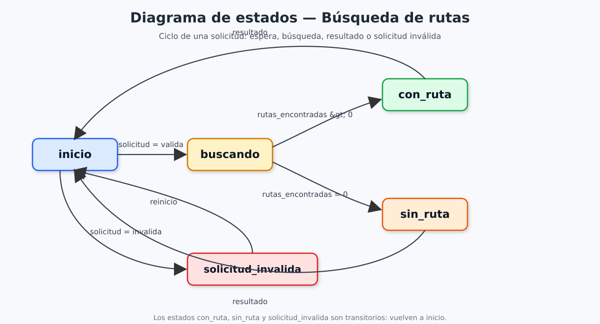
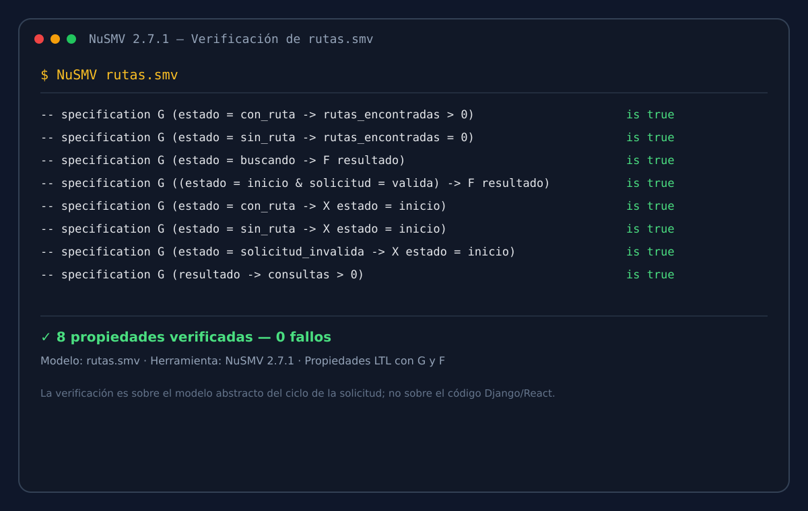

# Sistema de Transición de Estados: Búsqueda de Rutas

**Proyecto:** Sistema de Planificación de Viajes en Transporte Público (aqpTracker)  
**Componente:** Búsqueda de rutas directas y combinadas  
**Herramienta:** NuSMV 2.7.1  
**Modelo:** `rutas.smv`

## 1. Objetivo

Identificar los estados, variables, condiciones de transición y asignaciones del sistema de transición de estados del componente de búsqueda de rutas, y presentar la justificación de cada elemento.

## 2. Alcance

El modelo cubre el ciclo de una solicitud de búsqueda de rutas. No cubre el algoritmo de búsqueda, los datos de las rutas, la interfaz ni el código Django/React. El algoritmo y los datos se especifican en el modelo VDM++ del proyecto.

## 3. Definición del sistema de transición de estados

Un sistema de transición de estados se representa como:

```text
M = (S, S0, →, AP, L)
```

donde `S` es el conjunto de estados, `S0` es el conjunto de estados de partida, `→` es la relación de transición, `AP` es el conjunto de proposiciones atómicas y `L` asigna proposiciones a estados.

En NuSMV, el sistema se define con variables de dominio finito, asignaciones `init` y asignaciones `next`. Las propiedades se expresan en LTL:

- `G φ`: φ se cumple en todos los estados de todos los caminos.
- `F φ`: φ se cumple en algún estado que se alcanza en todos los caminos.

### 3.1 Contexto metodológico

La traducción de modelos de estado a verificadores simbólicos se ha aplicado en diversos dominios. Kochaleema y Santhosh Kumar (2022) traducen Statecharts UML a sistemas de transición etiquetados y verifican propiedades CTL/LTL; Hlaoui y Ayari (2025) compilan modelos de proceso correctos por construcción a NuSMV; y Xavier et al. (2024) sintetizan máquinas de estado desde registros de eventos y las verifican con NuSMV. Este trabajo adopta el mismo enfoque: un modelo abstracto de estados, propiedades LTL y verificación con NuSMV.

## 4. Estados

El modelo tiene cinco estados:

| Estado | Significado |
|--------|-------------|
| `inicio` | Espera de una solicitud |
| `buscando` | Proceso de búsqueda de una solicitud con valor `valida` |
| `con_ruta` | Resultado con al menos una ruta |
| `sin_ruta` | Resultado sin rutas |
| `solicitud_invalida` | Solicitud con valor `invalida` |

Los estados `con_ruta`, `sin_ruta` y `solicitud_invalida` vuelven a `inicio` después de mostrar el resultado.



**Figura 1.** Diagrama de estados de la búsqueda de rutas.

## 5. Variables

| Variable | Dominio | Función |
|----------|---------|---------|
| `estado` | `{inicio, buscando, con_ruta, sin_ruta, solicitud_invalida}` | Indica el estado del ciclo |
| `solicitud` | `{ninguna, valida, invalida}` | Representa la entrada del usuario |
| `rutas_encontradas` | `0..10` | Indica el número de rutas del resultado |
| `consultas` | `0..10` | Cuenta las solicitudes con valor `valida` |

Estado de partida:

```text
estado = inicio
solicitud = ninguna
rutas_encontradas = 0
consultas = 0
```

## 6. Condiciones de transición

| Estado de origen | Condición | Estado de destino |
|---------------|-----------|------------------|
| `inicio` | `solicitud = valida` | `buscando` |
| `inicio` | `solicitud = invalida` | `solicitud_invalida` |
| `buscando` | `rutas_encontradas > 0` | `con_ruta` |
| `buscando` | `rutas_encontradas = 0` | `sin_ruta` |
| `con_ruta` | — | `inicio` |
| `sin_ruta` | — | `inicio` |
| `solicitud_invalida` | — | `inicio` |

## 7. Asignaciones y actualizaciones

| Variable | Actualización |
|----------|---------------|
| `solicitud` | Cambia en `inicio` a `ninguna`, `valida` o `invalida`; en otros estados conserva su valor |
| `rutas_encontradas` | Se asigna en `inicio` con `solicitud = valida` a un valor de `0..3`; en otros estados conserva su valor |
| `consultas` | Incrementa en 1 en `inicio` con `solicitud = valida` y `consultas < 10`; en otros estados conserva su valor |
| `estado` | Cambia según las condiciones de la tabla de la sección 6 |

Fragmento de las asignaciones de estado:

```smv
next(estado) := case
  estado = inicio & solicitud = valida      : buscando;
  estado = inicio & solicitud = invalida    : solicitud_invalida;
  estado = buscando & rutas_encontradas > 0 : con_ruta;
  estado = buscando & rutas_encontradas = 0 : sin_ruta;
  estado = con_ruta                         : inicio;
  estado = sin_ruta                         : inicio;
  estado = solicitud_invalida                            : inicio;
  TRUE                                      : estado;
esac;
```

## 8. Código NuSMV

```smv
MODULE main
VAR
  estado            : {inicio, buscando, con_ruta, sin_ruta, solicitud_invalida};
  solicitud         : {ninguna, valida, invalida};
  rutas_encontradas : 0..10;
  consultas         : 0..10;

ASSIGN
  init(estado)            := inicio;
  init(solicitud)         := ninguna;
  init(rutas_encontradas) := 0;
  init(consultas)         := 0;

  next(estado) := case
    estado = inicio & solicitud = valida      : buscando;
    estado = inicio & solicitud = invalida    : solicitud_invalida;
    estado = buscando & rutas_encontradas > 0 : con_ruta;
    estado = buscando & rutas_encontradas = 0 : sin_ruta;
    estado = con_ruta                         : inicio;
    estado = sin_ruta                         : inicio;
    estado = solicitud_invalida                            : inicio;
    TRUE                                      : estado;
  esac;

  next(solicitud) := case
    estado = inicio : {ninguna, valida, invalida};
    TRUE            : solicitud;
  esac;

  next(rutas_encontradas) := case
    estado = inicio & solicitud = valida : {0, 1, 2, 3};
    TRUE                                 : rutas_encontradas;
  esac;

  next(consultas) := case
    estado = inicio & solicitud = valida & consultas < 10 : consultas + 1;
    TRUE                                                   : consultas;
  esac;

DEFINE
  resultado := (estado = con_ruta | estado = sin_ruta);

LTLSPEC G (estado = con_ruta -> rutas_encontradas > 0);
LTLSPEC G (estado = sin_ruta -> rutas_encontradas = 0);
LTLSPEC G (estado = buscando -> F resultado);
LTLSPEC G (estado = inicio & solicitud = valida -> F resultado);
LTLSPEC G (estado = con_ruta -> X estado = inicio);
LTLSPEC G (estado = sin_ruta -> X estado = inicio);
LTLSPEC G (estado = solicitud_invalida -> X estado = inicio);
LTLSPEC G (resultado -> consultas > 0);
```

## 9. Requerimiento con G y F

El requerimiento es: toda solicitud con valor `valida` alcanza un estado `con_ruta` o `sin_ruta`.

```smv
LTLSPEC G (estado = inicio & solicitud = valida -> F resultado);
```

`G` exige que la implicación se cumpla en todos los estados que se alcanzan. `F` exige que, cuando `solicitud = valida` en `inicio`, exista un estado con `resultado` evaluado como `true`.

Propiedades y resultado:

| ID | Propiedad | Resultado |
|----|-----------|-----------|
| R1 | `G (estado = con_ruta -> rutas_encontradas > 0)` | `true` |
| R2 | `G (estado = sin_ruta -> rutas_encontradas = 0)` | `true` |
| R3 | `G (estado = buscando -> F resultado)` | `true` |
| R4 | `G (estado = inicio & solicitud = valida -> F resultado)` | `true` |
| R5 | `G (estado = con_ruta -> X estado = inicio)` | `true` |
| R6 | `G (estado = sin_ruta -> X estado = inicio)` | `true` |
| R7 | `G (estado = solicitud_invalida -> X estado = inicio)` | `true` |
| R8 | `G (resultado -> consultas > 0)` | `true` |

Comando de ejecución:

```bash
NuSMV rutas.smv
```

Salida de NuSMV:

```text
-- specification  G (estado = con_ruta -> rutas_encontradas > 0)  is true
-- specification  G (estado = sin_ruta -> rutas_encontradas = 0)  is true
-- specification  G (estado = buscando ->  F resultado)  is true
-- specification  G ((estado = inicio & solicitud = valida) ->  F resultado)  is true
-- specification  G (estado = con_ruta ->  X estado = inicio)  is true
-- specification  G (estado = sin_ruta ->  X estado = inicio)  is true
-- specification  G (estado = solicitud_invalida ->  X estado = inicio)  is true
-- specification  G (resultado -> consultas > 0)  is true
```



**Figura 2.** Salida de NuSMV para `rutas.smv`.

## 10. Propiedad que no se cumple

La propiedad:

```smv
LTLSPEC G (estado = inicio -> F estado = con_ruta);
```

devuelve `false`. El contraejemplo es una ejecución con `solicitud = ninguna` en todos los estados; el sistema permanece en `inicio` y no alcanza `con_ruta`.

El modelo con esta propiedad adicional y su salida se conservan en `rutas_propiedad_falsa.smv` y `salida_rutas_falsa_nusmv.txt`.

La interpretación es que no toda solicitud produce una ruta. El requerimiento R4 cubre los casos en los que `solicitud = valida`; no exige que toda solicitud tenga una ruta.

## 11. Justificación del diseño

### 11.1 Estados

- `inicio` separa la espera de una solicitud del procesamiento.
- `buscando` representa el intervalo entre la solicitud y el resultado.
- `con_ruta` y `sin_ruta` separan los dos resultados de la búsqueda.
- `solicitud_invalida` separa una solicitud con valor `invalida` de una búsqueda sin rutas.
- `con_ruta`, `sin_ruta` y `solicitud_invalida` vuelven a `inicio` porque el resultado se muestra y el sistema puede recibir otra solicitud.
- No se usan estados separados para búsqueda directa y combinada porque el ciclo de la solicitud es el mismo; la diferencia se encuentra en el algoritmo VDM++.

### 11.2 Variables

- `estado` controla la transición y la respuesta del sistema.
- `solicitud` representa la entrada que activa la búsqueda o la solicitud inválida.
- `rutas_encontradas` determina el paso a `con_ruta` o `sin_ruta`.
- `consultas` registra las solicitudes con valor `valida` y permite la propiedad R8.
- No se incluyen coordenadas, radios ni transbordos porque son parámetros del algoritmo de búsqueda y se modelan en VDM++.

### 11.3 Condiciones

- `solicitud = valida` y `solicitud = invalida` separan la validación de la búsqueda.
- `rutas_encontradas > 0` y `rutas_encontradas = 0` separan los dos resultados de la búsqueda.
- El retorno a `inicio` no requiere otra variable porque ocurre después de mostrar el resultado.

### 11.4 Asignaciones

- `rutas_encontradas` se asigna al iniciar la búsqueda para que `buscando` pueda clasificar el resultado en el paso que sigue.
- La asignación de `rutas_encontradas` no tiene una regla de selección y representa los valores `0..3`.
- `consultas` incrementa solo con `solicitud = valida` para no contar solicitudes con valor `invalida`.
- `solicitud` cambia solo en `inicio` para conservar la entrada durante la búsqueda.
- Los estados `con_ruta`, `sin_ruta` y `solicitud_invalida` vuelven a `inicio` para permitir otra solicitud.

## 12. Relación con el proyecto

| Elemento del modelo | Elemento del proyecto |
|---------------------|-----------------------|
| `solicitud` | Petición POST a `buscar_rutas_view` o `buscar_rutas_combinadas_view` |
| `rutas_encontradas` | Longitud de `rutas_directas` o `rutas_combinadas` en la respuesta |
| `consultas` | Contador de búsquedas |
| `estado` | Estados de la interfaz: espera, proceso, resultado, sin resultado, solicitud inválida |
| `con_ruta` | RF1/RF2 con al menos una ruta |
| `sin_ruta` | RF1/RF2 sin rutas |

El backend procesa cada petición y responde; no conserva un estado entre peticiones. El modelo describe el comportamiento de una solicitud y se puede implementar en la interfaz o en un servicio de búsqueda.

La diferencia entre búsqueda directa y combinada, los radios y los transbordos se encuentran en el modelo VDM++. El modelo NuSMV cubre el ciclo de la solicitud.

## 13. Anexo: modelo de incidencias

El modelo del ciclo de vida de una incidencia del foro se conserva como anexo:

- `Anexo_Incidencias.md`
- `Anexo_Incidencias.tex`
- `incidencias.smv`
- `salida_nusmv.txt`

Estados: `activo`, `en_proceso`, `resuelto`, `falso`. Este modelo no forma parte del alcance de la búsqueda de rutas.

## 14. Conclusiones

- El sistema de transición de estados de la búsqueda de rutas tiene cinco estados y cuatro variables.
- Las condiciones separan la validación, la búsqueda y el resultado.
- Las asignaciones fijan el resultado al iniciar la búsqueda, cuentan las solicitudes con valor `valida` y devuelven el sistema a `inicio`.
- La propiedad R4 se cumple en NuSMV 2.7.1.
- La propiedad `G (estado = inicio -> F estado = con_ruta)` no se cumple; el modelo distingue una búsqueda sin rutas de una búsqueda con rutas.
- El modelo cubre el ciclo de la solicitud; el algoritmo y los datos se encuentran en VDM++.

## 15. Referencias

- NuSMV. *NuSMV: A New Symbolic Model Checker*. <https://nusmv.fbk.eu/>
- Kochaleema, K. H.; Santhosh Kumar, G. *Generic Methodology for Formal Verification of UML Models*. Defence Science Journal, 72(1), 40–48, 2022. DOI: 10.14429/dsj.72.17228.
- Hlaoui, Y. B.; Ayari, S. *An Approach to Develop Correct-by-Construction Business Process Models Using a Formal Domain Specific Language*. Journal of Software: Evolution and Process, 37(2), e2762, 2025. DOI: 10.1002/smr.2762.
- Xavier, M.; Dubinin, V.; Patil, S.; Vyatkin, V. *A Framework for the Generation of Monitor and Plant Model From Event Logs Using Process Mining for Formal Verification of Event-Driven Systems*. IEEE Open Journal of the Industrial Electronics Society, 5, 517–534, 2024. DOI: 10.1109/OJIES.2024.3406059.
- Nivon, Q.; Salaün, G. *Debugging of BPMN Processes Using Coloring Techniques*. Lecture Notes in Computer Science, 2022, pp. 90–109. DOI: 10.1007/978-3-031-20872-0_6.

## 16. Archivos

- `rutas.smv`: modelo NuSMV.
- `salida_rutas_nusmv.txt`: salida de NuSMV.
- `rutas_propiedad_falsa.smv`: modelo con la propiedad que no se cumple.
- `salida_rutas_falsa_nusmv.txt`: salida con el contraejemplo.
- `diagrama_estados_rutas.svg`: diagrama de estados.
- `evidencia_nusmv.svg`: salida de NuSMV en formato de imagen.
- `Ejercicio_Practico_4.md` y `Ejercicio_Practico_4.tex`: reporte del ejercicio.
- `Presentacion_Rutas.md`: guía de la presentación.
- `Anexo_Incidencias.md` y `Anexo_Incidencias.tex`: anexo del modelo de incidencias.
