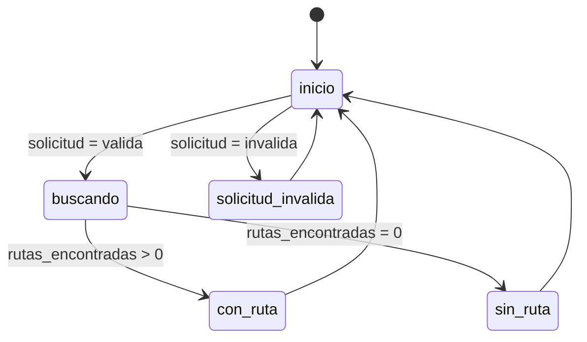

## Diapositiva 1 — Estados del sistema

**Idea central:** el sistema tiene cinco estados que representan el ciclo de una solicitud de búsqueda.

**Contenido en pantalla:**

| Estado | Significado |
|--------|-------------|
| `inicio` | Esperando una solicitud |
| `buscando` | Solicitud válida en proceso |
| `con_ruta` | Se encontró al menos una ruta |
| `sin_ruta` | No se encontró ninguna ruta |
| `solicitud_invalida` | La solicitud es inválida |



## Diapositiva 2 — Variables del sistema

**Idea central:** cuatro variables capturan la entrada, el resultado, el uso y el control del ciclo.

**Contenido en pantalla:**

| Variable | Dominio | ¿Para qué sirve? |
|----------|---------|------------------|
| `estado` | `{inicio, buscando, con_ruta, sin_ruta, solicitud_invalida}` | Controla la transición y la respuesta de la interfaz |
| `solicitud` | `{ninguna, valida, invalida}` | Modela la entrada del usuario |
| `rutas_encontradas` | `0..10` | Decide si el resultado es `con_ruta` o `sin_ruta` |
| `consultas` | `0..10` | Cuenta solicitudes válidas procesadas |

**Estado inicial:**

```text
estado = inicio
solicitud = ninguna
rutas_encontradas = 0
consultas = 0
```

## Diapositiva 3 — Condiciones de transición

**Idea central:** las guardas validan la solicitud antes de buscar y clasifican el resultado.

**Contenido en pantalla:**

| Estado actual | Condición | Estado siguiente |
|---------------|-----------|------------------|
| `inicio` | `solicitud = valida` | `buscando` |
| `inicio` | `solicitud = invalida` | `solicitud_invalida` |
| `buscando` | `rutas_encontradas > 0` | `con_ruta` |
| `buscando` | `rutas_encontradas = 0` | `sin_ruta` |
| `con_ruta` | — | `inicio` |
| `sin_ruta` | — | `inicio` |
| `solicitud_invalida` | — | `inicio` |

## Diapositiva 4 — Asignaciones y actualizaciones

**Idea central:** las asignaciones fijan el resultado al iniciar la búsqueda, cuentan solo solicitudes válidas y devuelven la interfaz a `inicio`.

**Contenido en pantalla:**

| Variable | Actualización |
|----------|---------------|
| `solicitud` | Cambia solo en `inicio`; fuera de allí permanece |
| `rutas_encontradas` | Se asigna al iniciar una búsqueda válida; valor no determinista en `0..3` |
| `consultas` | Incrementa solo con solicitudes válidas y hasta 10 |
| `estado` | Sigue las guardas de la tabla anterior |

**Fragmento de código para la diapositiva:**

```smv
next(estado) := case
  estado = inicio & solicitud = valida      : buscando;
  estado = inicio & solicitud = invalida    : solicitud_invalida;
  estado = buscando & rutas_encontradas > 0 : con_ruta;
  estado = buscando & rutas_encontradas = 0 : sin_ruta;
  estado = con_ruta                         : inicio;
  estado = sin_ruta                         : inicio;
  estado = solicitud_invalida                            : inicio;
  TRUE                                      : estado;
esac;
```

## Diapositiva 5 — Requerimiento verificado con G y F

**Idea central:** toda solicitud válida eventualmente alcanza un resultado.

**Contenido en pantalla:**

```smv
LTLSPEC G (estado = inicio & solicitud = valida -> F resultado);
```

Donde:

```smv
DEFINE resultado := (estado = con_ruta | estado = sin_ruta);
```

**Lectura de la fórmula:**

- `G`: la implicación se cumple en todos los estados alcanzables.
- `F`: cuando llega una solicitud válida, eventualmente se alcanza `con_ruta` o `sin_ruta`.
- Resultado en NuSMV: **`true`**.

**Propiedades complementarias:**

| ID | Propiedad | Resultado |
|----|-----------|-----------|
| R1 | `G (con_ruta -> rutas_encontradas > 0)` | `true` |
| R2 | `G (sin_ruta -> rutas_encontradas = 0)` | `true` |
| R3 | `G (buscando -> F resultado)` | `true` |
| R4 | `G (inicio & solicitud = valida -> F resultado)` | `true` |
| R5 | `G (con_ruta -> X inicio)` | `true` |
| R6 | `G (sin_ruta -> X inicio)` | `true` |
| R7 | `G (solicitud_invalida -> X inicio)` | `true` |
| R8 | `G (resultado -> consultas > 0)` | `true` |

**Propiedad que no se cumple (y es correcto):**

```smv
LTLSPEC G (estado = inicio -> F estado = con_ruta);
```

- NuSMV devuelve `false`.
- Contraejemplo: `solicitud = ninguna` para siempre; el sistema se queda en `inicio`.
- Interpretación: no toda solicitud encuentra una ruta; el requisito correcto es alcanzar un resultado (`con_ruta` o `sin_ruta`), no “siempre hay ruta”.


## Diapositiva 6 — Justificación del diseño

**Idea central:** cada elemento del modelo responde a una decisión de diseño del ciclo de búsqueda.

**Contenido en pantalla:**

**¿Por qué estos estados?**

- `inicio`: punto de entrada y reposo; permite repetir búsquedas.
- `buscando`: separa la recepción de la solicitud del resultado; modela el tiempo de espera.
- `con_ruta` / `sin_ruta`: dos resultados posibles de RF1/RF2; evitan confundir éxito con ausencia de rutas.
- `solicitud_invalida`: separa una solicitud inválida de una búsqueda sin resultados.
- Los resultados son transitorios: se muestran y se vuelve a `inicio`.
- No se separan búsquedas directas y combinadas: el ciclo es el mismo; el algoritmo está en VDM++.

**¿Por qué estas variables?**

- `estado`: controla el flujo y la respuesta de la interfaz.
- `solicitud`: modela la entrada del usuario.
- `rutas_encontradas`: decide el resultado.
- `consultas`: mide uso y solo cuenta solicitudes válidas.
- Coordenadas, radios y transbordos quedan en VDM++ porque son parámetros del algoritmo.

**¿Por qué estas condiciones y asignaciones?**

- Validan antes de buscar y clasifican el resultado según el número de rutas.
- `rutas_encontradas` se fija al iniciar la búsqueda para clasificar en el paso siguiente.
- `consultas` incrementa solo con solicitudes válidas.
- `solicitud` solo cambia en `inicio`.
- Los resultados vuelven a `inicio` para no bloquear el sistema.

## Diapositiva 7 — Conclusiones y alcance

**Idea central:** el modelo es verificable, trazable y coherente con el proyecto, pero es una abstracción del comportamiento.

**Contenido en pantalla:**

- **Estados:** representan el ciclo de una solicitud: espera, búsqueda, resultado o solicitud inválida.
- **Variables:** capturan entrada, resultado, uso y control.
- **Condiciones:** validan la solicitud y clasifican el resultado.
- **Asignaciones:** garantizan que el resultado se fije al buscar y que la interfaz vuelva a `inicio`.
- **Verificación:** 8 propiedades `true` con NuSMV 2.7.1.
- **Alcance:** el backend actual es stateless; el modelo especifica el comportamiento observable y sirve para una futura máquina de estados en el frontend o en un servicio de búsqueda.
- **Separación:** la búsqueda directa/combinada, los radios y los transbordos están en VDM++; la máquina de estados modela el ciclo común.

---

## Diapositiva de respaldo 1 — Código completo y salida de NuSMV

**Uso:** solo si la profesora pide ver el código o la salida.

**Contenido:**

- `rutas.smv` completo (o enlace al archivo).
- Salida de `NuSMV rutas.smv` con las 8 propiedades `true`.
- `rutas_propiedad_falsa.smv` y `salida_rutas_falsa_nusmv.txt` para la propiedad que devuelve `false`.
- Comando de ejecución:

```bash
NuSMV rutas.smv
```

---

## Diapositiva de respaldo 2 — Anexo: modelo de incidencias

**Uso:** solo si preguntan por el foro o por otros estados del proyecto.

**Contenido:**

- El modelo del ciclo de vida de una incidencia se conserva en `Anexo_Incidencias.md` y `incidencias.smv`.
- Estados: `activo`, `en_proceso`, `resuelto`, `falso`.
- No es el foco de esta presentación; se mantiene como ejemplo complementario.
---

