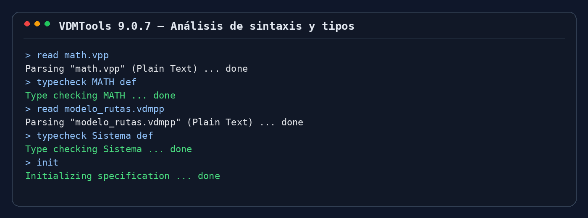
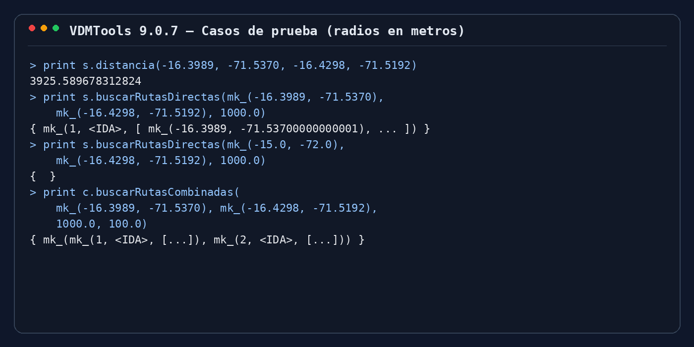
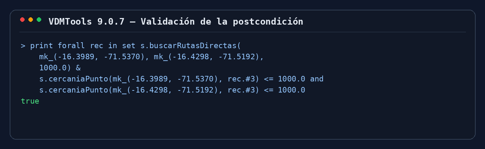

# Sistema de Planificación de Viajes en Transporte Público con Especificación en VDM++ y Verificación de Estados en NuSMV para la Ciudad de Arequipa

**Integrantes:** Alvarez Choque Miguel Angel, Cuno Salazar Eduardo Joel, Cruz Gallegos Jeremy Jeison, Inca Moncca Jherson David, Quispe Madariaga Jeferson Jofre

**Universidad Nacional de San Agustín, Arequipa, Perú.**

## Resumen

La información sobre las rutas de transporte público en Arequipa es dispersa e imprecisa, lo que provoca desplazamientos ineficientes y decisiones de movilidad erróneas. Este trabajo propone una plataforma web para la búsqueda de rutas directas y combinadas. El algoritmo de planificación de viajes se especifica y valida formalmente con VDM++ y la VDM++ Toolbox mediante tipos, invariantes, precondiciones y postcondiciones. De forma complementaria, el ciclo de vida de una solicitud se modela como un sistema de transición de estados y se verifica con NuSMV mediante propiedades LTL. La validación del algoritmo se apoya en casos de prueba y obligaciones de prueba, mientras que la verificación del modelo de estados comprueba propiedades de seguridad, alcanzabilidad y retorno al estado inicial. Los resultados muestran que ambos modelos son complementarios y que ninguno sustituye la validación del código de la plataforma.

**Palabras clave:** métodos formales · VDM++ · NuSMV · LTL · transporte público · planificación de rutas

## 1. Introducción

El presente trabajo propone una plataforma web para la búsqueda de rutas de transporte en Arequipa. Su componente crítico, el algoritmo de búsqueda de rutas directas y combinadas, es especificado y validado formalmente mediante el lenguaje VDM++ (Fitzgerald et al., 2008), utilizando invariantes, precondiciones y postcondiciones. La validación del modelo se realiza con la herramienta VDMTools (Fitzgerald et al., 2008). De forma complementaria, el ciclo de vida de una solicitud se modela como un sistema de transición de estados y se verifica con NuSMV (NuSMV Team, 2025) mediante propiedades LTL.

El artículo se organiza de la siguiente manera. La Sección 2 revisa los trabajos relacionados con la especificación formal y la validación de sistemas de transporte. La Sección 3 presenta los requerimientos funcionales. La Sección 4 describe el modelo VDM++ del subsistema de rutas. La Sección 5 presenta el modelo de transición de estados y su verificación con NuSMV. La Sección 6 expone los casos de prueba ejecutados en la Toolbox. La Sección 7 resume los resultados de la validación. La Sección 8 discute el alcance de los resultados. La Sección 9 presenta las conclusiones. La Sección 10 describe las limitaciones y la Sección 11 las recomendaciones y trabajos futuros.

### 1.1 Definición del Problema

En la ciudad de Arequipa, la información sobre las rutas del transporte público es dispersa, está desactualizada y no se encuentra disponible de forma clara para el ciudadano. Ante la necesidad de desplazarse entre dos puntos, el usuario desconoce qué línea de bus tomar, cuáles son sus paraderos y si es necesario realizar un transbordo. Esta falta de información confiable produce pérdida de tiempo, desplazamientos innecesarios y decisiones de movilidad incorrectas.

La planificación de viajes en transporte público constituye una tarea computacionalmente *crítica*: un resultado erróneo (una ruta que no pasa cerca del origen, un transbordo inviable o una dirección de recorrido incorrecta) induce al usuario a tomar una decisión equivocada, con el consiguiente costo en tiempo y seguridad. Por este motivo, la correctitud del algoritmo de búsqueda de rutas no puede garantizarse únicamente mediante pruebas de ejecución; se requiere una especificación formal que demuestre propiedades sobre el resultado producido, tal como se argumenta para servicios de transporte validados formalmente (Iqbal et al., 2022b).

### 1.2 Objetivos

**Objetivo general**

Desarrollar una propuesta de solución para la planificación de viajes en transporte público, cuyo componente crítico, el algoritmo de búsqueda de rutas, sea especificado y validado formalmente con VDM++, y cuyo ciclo de solicitud sea verificado con NuSMV.

**Objetivos específicos**

1. Definir los tipos de datos e invariantes del dominio de rutas (recorridos, paraderos y radios de búsqueda).
2. Especificar en VDM++ las operaciones de búsqueda de rutas directas y de rutas combinadas mediante pre y postcondiciones.
3. Establecer las propiedades que el algoritmo debe garantizar, tales como la distancia máxima de acceso a una ruta y la viabilidad de los transbordos.
4. Validar el modelo formal con la herramienta VDM++ Toolbox mediante obligaciones de prueba y casos de prueba.
5. Modelar y verificar con NuSMV el sistema de transición de estados del ciclo de la solicitud.
6. Documentar los requerimientos funcionales y los trabajos relacionados que sustentan la propuesta.

## 2. Trabajos Relacionados

La especificación formal de sistemas de transporte y de aplicaciones web ha sido abordada con la familia de lenguajes VDM y con herramientas de validación basadas en modelos. A continuación se revisan los trabajos que sustentan la elección de VDM++ y de VDMTools, así como las aplicaciones recientes en dominios de transporte, modelado de estados y trazabilidad.

### 2.1 Soporte de herramientas

Fitzgerald, Larsen y Sahara (Fitzgerald et al., 2008) describen VDMTools, un conjunto de herramientas que analizan modelos expresados en VDM y sus dialectos VDM++ y VDM-RT, y que ofrecen verificación estática, generación automática de código, mapeo a UML, análisis de cobertura de pruebas y depuración. Los autores destacan que VDMTools está orientado al desarrollo rentable de modelos formales en entornos industriales. La herramienta se ha empleado en la validación de un servicio de transporte (Iqbal et al., 2022b); de forma complementaria, trabajos recientes de VDM++ utilizan la simulación de especificaciones para validar el comportamiento del software (Matsumoto et al., 2024). Estos antecedentes sustentan la elección de VDMTools para validar el algoritmo propuesto.

### 2.2 VDM en sistemas de transporte

Iqbal et al. (2022a) presentan un modelo formal en VDM-SL para la interacción entre vehículos e infraestructura de carretera en redes vehiculares (VANET). El trabajo combina UML, teoría de grafos y VDM-SL para representar la red y descubrir rutas de comunicación entre vehículos. Aunque el dominio corresponde a redes vehiculares y no a rutas de transporte público, el trabajo muestra el uso de VDM para especificar el descubrimiento de caminos y verificar la consistencia funcional antes de la implementación.

En Iqbal et al. (2022b), los autores validan con la VDM-SL Toolbox un modelo formal de un servicio de taxi en línea. El trabajo reporta la verificación y validación del modelo con la herramienta y cubre el ciclo de vida del servicio. Este antecedente es relevante porque aplica la validación con Toolbox a un servicio de transporte, aunque el lenguaje empleado es VDM-SL y el dominio es un servicio de taxi, no una red de rutas de bus.

### 2.3 VDM++ para modelado y aplicaciones web

Matsumoto et al. (2024) proponen una técnica de conversión de modelos EPNAT a especificaciones VDM++. La técnica extrae el estado abstracto del software y divide la especificación en clases asociadas a subredes, con el objetivo de mejorar la legibilidad y el mantenimiento del modelo. Este trabajo respalda la organización del modelo en clases y la identificación de estados que se emplea en la presente propuesta.

Ishigami et al. (2024) construyen especificaciones VDM++ a partir de diagramas de transición de pantallas extendidos para validar aplicaciones web basadas en el patrón MVC y en microservicios. El trabajo describe el comportamiento de los servicios en VDM++ y lo utiliza para localizar errores y sus causas. Este antecedente es el más cercano al contexto de una plataforma web, aunque no aborda la búsqueda de rutas de transporte.

Suga et al. (2022) proponen un método para generar clases y variables de instancia de una especificación VDM++ a partir de una especificación en lenguaje natural, con apoyo de aprendizaje automático. El trabajo se orienta a la trazabilidad entre los requisitos y la estructura del modelo; en esta propuesta, dicha trazabilidad se documenta mediante los requerimientos funcionales y las operaciones especificadas.

### 2.4 Verificación de modelos de estado

La verificación de propiedades temporales sobre modelos de estado se ha abordado mediante la traducción de Statecharts UML a sistemas de transición etiquetados y el chequeo de propiedades CTL/LTL (Kochaleema y Santhosh Kumar, 2022), la compilación de modelos de proceso a NuSMV (Hlaoui y Ayari, 2025), la síntesis de máquinas de estado a partir de registros de eventos y su verificación con NuSMV (Xavier et al., 2024), y técnicas de depuración de contraejemplos en procesos BPMN (Nivon y Salaün, 2022). Estos antecedentes sustentan el uso de NuSMV para verificar el ciclo de la solicitud, mientras que VDM++ se ocupa del algoritmo de búsqueda.

### 2.5 Brecha identificada

Los trabajos revisados se centran en redes vehiculares, servicios de taxi, generación de especificaciones, validación de aplicaciones web o verificación de flujos de proceso. No se encontró un trabajo que combine VDM++ para especificar el algoritmo de búsqueda de rutas y NuSMV para verificar el ciclo de estados de una solicitud en una plataforma web de transporte público. Esta propuesta integra ambos modelos: una clase VDM++ que formaliza los recorridos y las operaciones de búsqueda, y un modelo NuSMV que verifica el flujo observable de la solicitud.

## 3. Requerimientos Funcionales

La propuesta plantea una plataforma web con dos funcionalidades principales: la búsqueda de rutas de transporte y el reporte colaborativo de incidencias urbanas. Los requerimientos funcionales que se describen a continuación constituyen la base de la especificación formal; los requerimientos RF1 y RF2 son los que serán especificados y verificados con VDM++.

| ID | Requerimiento funcional |
|----|-------------------------|
| RF1 | Búsqueda de rutas directas: para un origen y un destino dados, el sistema debe devolver las rutas cuyo recorrido pase a una distancia menor o igual a un radio definido (1000 m) de ambos puntos. |
| RF2 | Búsqueda de rutas combinadas: el sistema debe devolver combinaciones de dos rutas con un punto de transbordo viable, respetando una distancia máxima de transbordo (100 m). |
| RF3 | Visualización en mapa: el sistema debe mostrar en un mapa interactivo el recorrido de las rutas y sus paraderos. |
| RF4 | Estimación de distancia y tiempo: el sistema debe calcular la distancia total del viaje y un tiempo estimado, incluyendo el tiempo de transbordo. |
| RF5 | Gestión de datos de rutas: el sistema debe permitir cargar rutas desde archivos KML y asociar los paraderos cercanos a cada recorrido. |

Los requerimientos RF1 y RF2 se formalizarán en VDM++ con tipos, invariantes y pre/postcondiciones. Adicionalmente, el ciclo de vida de una solicitud se modela como un sistema de transición de estados y se verifica con NuSMV.

## 4. Modelo en VDM++

El componente crítico del sistema, el algoritmo de búsqueda de rutas, se especificó como una clase VDM++ denominada `Sistema`. El modelo cubre los elementos del lenguaje requeridos: tipos *quote*, *token*, registros con invariantes, secuencias, conjuntos y mapas.



### 4.1 Tipos e invariantes

La especificación define un tipo *quote* para el sentido, dos tipos *token* para los identificadores opacos, y dos registros con sus invariantes:

```
class Sistema
types
  public Sentido    = <IDA> | <VUELTA>;      -- quote
  public RutaId     = token;                 -- token
  public ParaderoId = token;                 -- token

  public Punto :: lat : real                 -- record
                  lng : real
  inv p == p.lat >= -90 and p.lat <= 90 and
           p.lng >= -180 and p.lng <= 180;

  public Recorrido :: ruta : RutaId          -- record
             sentido : Sentido
             coordenadas : seq of Punto
  inv r == len r.coordenadas >= 2;

instance variables
  recorridos : set of Recorrido := {};
  paraderos  : set of ParaderoId := {};
```

Los *quote* representan valores simbólicos de un dominio cerrado (ida o vuelta); los *token* representan identificadores opacos que solo admiten igualdad; y los registros agrupan campos con nombre. Las invariantes restringen los valores: las coordenadas deben estar en el rango geográfico (−90° ≤ lat ≤ 90° y −180° ≤ lng ≤ 180°) y todo recorrido debe tener al menos dos puntos.

### 4.2 Colecciones: secuencia, conjunto y mapa

Se usan **secuencias** (`seq of Punto`) para las coordenadas, porque el orden define el trayecto y un punto puede repetirse; y **conjuntos** (`set of Recorrido`, `set of ParaderoId`) para los catálogos, donde el orden no importa y no debe haber duplicados. Además, se propone un **mapa** que relaciona cada ruta con sus recorridos:

```
recorridosPorRuta : map RutaId to set of Recorrido
inv recorridosPorRuta ==
  (forall r in set dom recorridosPorRuta &
     card recorridosPorRuta(r) <= 2)
  and
  (forall r in set dom recorridosPorRuta &
     forall rec in set recorridosPorRuta(r) & rec.ruta = r);
```

La invariante del mapa expresa que cada ruta tiene a lo sumo dos recorridos (ida y vuelta) y que cada recorrido referencia a su ruta.

### 4.3 Implementación validada

Por limitaciones de la versión de la Toolbox (VDMTools 9.0.7), la implementación ejecutable representa los registros como tipos producto y los *token* como naturales, preservando la semántica y las invariantes:

```
types
  public Sentido   = <IDA> | <VUELTA>;
  public RutaId    = nat;
  public Punto     = real * real
    inv p == p.#1 >= -90 and p.#1 <= 90 and
             p.#2 >= -180 and p.#2 <= 180;
  public Recorrido = RutaId * Sentido * seq of Punto
    inv r == len r.#3 >= 2;
```

### 4.4 Función de distancia

La distancia entre dos coordenadas se calcula con la fórmula de Haversine y se expresa en metros. La implementación usa la librería `MATH` de la Toolbox para las funciones trigonométricas y la raíz cuadrada, y define el radio medio terrestre como una constante del modelo:

```vpp
values
  R_TIERRA : real = 6371000.0;

public distancia : real * real * real * real -> real
distancia(lat1, lng1, lat2, lng2) ==
  let rad = MATH`pi / 180.0,
      dLat = (lat2 - lat1) * rad,
      dLng = (lng2 - lng1) * rad,
      a = MATH`sin(dLat / 2.0) * MATH`sin(dLat / 2.0) +
          MATH`cos(lat1 * rad) * MATH`cos(lat2 * rad) *
          MATH`sin(dLng / 2.0) * MATH`sin(dLng / 2.0),
      aAcot = if a > 1.0 then 1.0 else a
  in 2.0 * R_TIERRA * MATH`asin(MATH`sqrt(aAcot));
```

La fórmula convierte las coordenadas de grados a radianes, calcula el término `a` de Haversine y obtiene la distancia con `2R asin(sqrt(a))`. El valor `a` se acota a `1.0` para evitar errores de redondeo en `asin`. La librería `MATH` de VDMTools 9.0.7 no expone `atan2`, por lo que se emplea la forma equivalente con `asin`; la implementación del backend usa `atan2` y ambas expresiones son algebraicamente equivalentes. Los parámetros `radio` y `radioTransbordo` de las operaciones de búsqueda se expresan en metros.

### 4.5 Operaciones y postcondiciones

`buscarRutasDirectas` (RF1) devuelve los recorridos que pasan a una distancia menor o igual a `radio` del origen `A` y del destino `B` (en la implementación, `coordenadas` se accede como `rec.#3`):

```
public buscarRutasDirectas : Punto * Punto * real ==> set of Recorrido
buscarRutasDirectas(A, B, radio) ==
  return { rec | rec in set recorridos &
       cercaniaPunto(A, rec.#3) <= radio and
       cercaniaPunto(B, rec.#3) <= radio }
pre A <> B
post forall rec in set RESULT &
       cercaniaPunto(A, rec.#3) <= radio and
       cercaniaPunto(B, rec.#3) <= radio;
```

La postcondición formaliza la propiedad central: toda ruta devuelta está a una distancia menor o igual al radio respecto del origen y del destino. `buscarRutasCombinadas` (RF2) extiende la búsqueda a pares de recorridos con transbordo, exigiendo además que las rutas sean distintas y que exista un transbordo dentro de `radioTransbordo`.

### 4.6 Diagrama de clases

El diagrama de clases del dominio se documenta en PlantUML (una empresa tiene varias rutas; cada ruta tiene uno o dos recorridos; y cada recorrido se asocia con paraderos mediante `RecorridoParadero`):

```plantuml
@startuml
class Empresa { nombre; descripcion }
class Ruta { nombre; codigo }
class Recorrido { sentido; coordenadas }
class Paradero { nombre; latitud; longitud }
class RecorridoParadero { orden; distancia }
Empresa "1" --> "*" Ruta
Ruta "1" --> "1..2" Recorrido
Recorrido "1" --> "*" RecorridoParadero
Paradero "1" --> "*" RecorridoParadero
@enduml
```


## 5. Modelo de transición de estados en NuSMV

El modelo VDM++ de la Sección 4 especifica el algoritmo de búsqueda. De forma complementaria, el ciclo de vida de una solicitud se representa como un sistema de transición de estados finito y se verifica con NuSMV 2.7.1 (NuSMV Team, 2025). Este modelo no describe el algoritmo ni los datos de las rutas: describe los estados observables entre la recepción de una solicitud y la presentación del resultado. La separación permite validar el algoritmo con VDM++ y verificar el flujo de la solicitud con una herramienta de model checking.

### 5.1 Estados y variables

El modelo define cinco estados. El estado `solicitud_invalida` se denomina así, y no `error`, para distinguir un rechazo por validación de un fallo técnico del sistema.

| Estado | Significado |
|--------|-------------|
| `inicio` | Espera de una solicitud |
| `buscando` | Solicitud válida en proceso |
| `con_ruta` | Resultado con al menos una ruta |
| `sin_ruta` | Resultado sin rutas |
| `solicitud_invalida` | Solicitud rechazada por validación |

Las variables del modelo son:

- `estado`, con dominio `{inicio, buscando, con_ruta, sin_ruta, solicitud_invalida}`: controla la transición y la respuesta observable.
- `solicitud`, con dominio `{ninguna, valida, invalida}`: representa la entrada del usuario.
- `rutas_encontradas`, en el rango `0..10`: determina si el resultado es `con_ruta` o `sin_ruta`.
- `consultas`, en el rango `0..10`: cuenta las solicitudes válidas procesadas.

El estado inicial es `estado = inicio`, `solicitud = ninguna`, `rutas_encontradas = 0` y `consultas = 0`.

### 5.2 Transiciones y asignaciones

Las transiciones están gobernadas por guardas: `inicio` pasa a `buscando` si `solicitud = valida`, y a `solicitud_invalida` si `solicitud = invalida`; `buscando` pasa a `con_ruta` si `rutas_encontradas > 0`, y a `sin_ruta` si `rutas_encontradas = 0`; los estados de resultado y de solicitud inválida vuelven a `inicio`.

```smv
next(estado) := case
  estado = inicio & solicitud = valida      : buscando;
  estado = inicio & solicitud = invalida    : solicitud_invalida;
  estado = buscando & rutas_encontradas > 0 : con_ruta;
  estado = buscando & rutas_encontradas = 0 : sin_ruta;
  estado = con_ruta                         : inicio;
  estado = sin_ruta                         : inicio;
  estado = solicitud_invalida               : inicio;
  TRUE                                      : estado;
esac;
```

Al iniciar una búsqueda válida, `rutas_encontradas` se asigna de forma no determinista en `0..3` y `consultas` se incrementa; en los demás estados ambas variables conservan su valor. La asignación no determinista representa los posibles resultados del algoritmo, no su lógica interna. `solicitud` cambia solo en `inicio`, de modo que la entrada permanece estable durante la búsqueda.

### 5.3 Propiedades LTL y resultados

La verificación se realizó con NuSMV 2.7.1. Las ocho propiedades LTL verificadas son:

```smv
LTLSPEC G (estado = con_ruta -> rutas_encontradas > 0);
LTLSPEC G (estado = sin_ruta -> rutas_encontradas = 0);
LTLSPEC G (estado = buscando -> F resultado);
LTLSPEC G (estado = inicio & solicitud = valida -> F resultado);
LTLSPEC G (estado = con_ruta -> X estado = inicio);
LTLSPEC G (estado = sin_ruta -> X estado = inicio);
LTLSPEC G (estado = solicitud_invalida -> X estado = inicio);
LTLSPEC G (resultado -> consultas > 0);
```

Las ocho propiedades devuelven `true`. En particular, toda solicitud válida alcanza eventualmente `con_ruta` o `sin_ruta`; los estados de resultado implican el número de rutas correspondiente; y los estados transitorios vuelven a `inicio`. La propiedad `G (estado = inicio -> F estado = con_ruta)` devuelve `false`: si `solicitud` permanece en `ninguna`, el sistema permanece en `inicio` y no alcanza `con_ruta`. El contraejemplo confirma que el modelo distingue una búsqueda sin resultados de una búsqueda que no se inició; el requerimiento correcto es alcanzar un resultado, no garantizar que toda solicitud encuentre una ruta.

El modelo es una abstracción del ciclo de la solicitud. El backend actual es stateless y el modelo no verifica el código Django/React; la verificación se aplica al modelo abstracto y complementa la validación VDM++ del algoritmo descrita en las Secciones 4 y 6.

## 6. Pruebas

La validación del modelo se realizó ejecutando casos de prueba en el intérprete de la VDM++ Toolbox, usando la Plaza de Armas como origen y el Terminal Terrestre como destino. Los radios se expresan en metros.

| Caso | Entrada | Resultado |
|------|---------|-----------|
| P1 | Origen y destino sobre el recorrido, radio 1000 m | Devuelve la ruta |
| N1 | Origen lejano, radio 1000 m | Conjunto vacío |
| C1 | Dos recorridos con transbordo, radio 1000 m y radioTransbordo 100 m | Par de rutas |

La distancia Haversine entre la Plaza de Armas y el Terminal Terrestre es de aproximadamente 3925.59 m. En el caso positivo, el recorrido contiene puntos exactamente en el origen y el destino, por lo que la distancia mínima es nula. En el caso negativo se usa un origen lejano, de modo que ningún recorrido cumple la restricción y el resultado es el conjunto vacío. En el caso combinado, dos recorridos comparten un punto de transbordo dentro del radio establecido. La distancia entre el origen y el destino se verifica con `s.distancia`; el resultado esperado es 3925.59 m.



## 7. Resultados

La validación del modelo VDM++ se centró en comprobar que las operaciones cumplen sus postcondiciones; la verificación del modelo de estados se reporta en la Sección 5. Además de ejecutar los casos de prueba, se evaluó directamente la postcondición de `buscarRutasDirectas` sobre el resultado, que devuelve `true`; esto confirma que todos los recorridos devueltos se encuentran dentro del radio respecto del origen y del destino.



Adicionalmente, la Toolbox generó las obligaciones de prueba (*proof obligations*) asociadas a las postcondiciones de las operaciones de búsqueda, que expresan formalmente las propiedades que el modelo debe satisfacer.


## 8. Discusión

Los resultados muestran que la especificación formal captura correctamente las propiedades centrales del algoritmo de búsqueda. Las postcondiciones de `buscarRutasDirectas` y `buscarRutasCombinadas` expresan con precisión las garantías del sistema: proximidad de las rutas al origen y al destino, y viabilidad de los transbordos.

Sin embargo, la validación por interpretación no equivale a una demostración deductiva completa: los casos de prueba cubren escenarios representativos, pero no prueban la postcondición para todas las entradas posibles. Las obligaciones de prueba generadas por la Toolbox constituyen el punto de partida para una verificación más rigurosa.

La función de distancia usa Haversine en metros y la forma equivalente con `asin`, porque la librería `MATH` de VDMTools 9.0.7 no expone `atan2`; el backend usa `atan2` y ambas expresiones coinciden algebraicamente. La distancia se evalúa contra los vértices del recorrido, igual que en el código, por lo que el modelo y la implementación son consistentes en el criterio de cercanía.

La verificación con NuSMV complementa este análisis. El modelo de estados no describe el algoritmo, pero permite comprobar propiedades de seguridad y alcanzabilidad del ciclo de la solicitud. Las ocho propiedades LTL verificadas devuelven `true`; la propiedad `G (estado = inicio -> F estado = con_ruta)` devuelve `false`, lo que confirma que el modelo distingue una búsqueda sin resultados de una búsqueda que no se inició. La verificación se aplica al modelo abstracto, no al backend ni a la interfaz.

## 9. Conclusiones

Se especificó y validó el algoritmo de búsqueda de rutas de una plataforma de planificación de viajes en transporte público para Arequipa, y se verificó el ciclo de vida de una solicitud mediante un modelo de transición de estados. El modelo VDM++ define los tipos del dominio, las operaciones de búsqueda de rutas directas y combinadas, y sus postcondiciones, que formalizan las garantías del algoritmo. El modelo NuSMV define los estados, variables, guardas y asignaciones del ciclo de la solicitud, y sus propiedades LTL formalizan la alcanzabilidad de un resultado y la coherencia del estado.

La validación en la VDM++ Toolbox permitió comprobar que el modelo es consistente, que las operaciones se ejecutan correctamente sobre casos de prueba representativos y que las postcondiciones se satisfacen. La verificación en NuSMV 2.7.1 permitió comprobar que las ocho propiedades LTL del modelo de estados son `true`, y que la propiedad que exige que toda solicitud encuentre una ruta es `false`, con un contraejemplo que mantiene la solicitud en `ninguna`.

## 10. Limitaciones

Primero, la distancia se calcula con Haversine sobre una esfera de radio 6 371 000 m y se evalúa contra los vértices del recorrido, no contra los segmentos; el backend aplica el mismo criterio, por lo que el modelo y el código son consistentes, pero la métrica es una aproximación de la distancia peatonal y puede sobreestimar la cercanía en segmentos largos. Segundo, por compatibilidad con la versión de la herramienta, los tipos registro se representaron como tipos producto (tuplas). Tercero, la validación se basó en interpretación y casos de prueba, no en una demostración deductiva completa. Finalmente, el conjunto de datos de prueba es reducido.

Adicionalmente, el modelo NuSMV es una abstracción del ciclo de la solicitud: no modela el algoritmo ni los datos de las rutas, y el backend actual es stateless. Por tanto, la verificación con NuSMV no sustituye la validación del código Django/React ni la validación del algoritmo en VDM++.

## 11. Recomendaciones y Trabajos Futuros

Como trabajo futuro se propone: (i) calcular la distancia punto-segmento para aproximar mejor la cercanía a la polilínea; (ii) incorporar la longitud mínima de segmento en la búsqueda combinada; (iii) completar la verificación demostrando formalmente las obligaciones de prueba; (iv) ampliar el modelo con cálculo de tiempo estimado y ordenamiento de resultados; (v) integrar los modelos VDM++ y NuSMV con la implementación web (Django y React); y (vi) ampliar los casos de prueba con datos reales de las rutas de Arequipa.

## 12. Enlaces de la entrega

- **Video de la presentación:** disponible en el Aula Virtual.
- **Repositorio del proyecto:** incluye el código de especificación formal, las salidas de VDMTools y NuSMV, y el archivo `README_Especificacion_Formal.md`.
- **Código de especificación formal:** `modelo_rutas.vdmpp`, `rutas.smv`, `rutas_propiedad_falsa.smv` y sus salidas.

El documento PDF de entrega incluye el artículo y las diapositivas de la presentación.

## Referencias

1. J. S. Fitzgerald, P. G. Larsen y S. Sahara, "VDMTools: Advances in Support for Formal Modeling in VDM", *ACM SIGPLAN Notices*, vol. 43, n.º 2, pp. 3–11, 2008. DOI: 10.1145/1361213.1361214.
2. S. Iqbal, N. A. Zafar, T. Ali y E. H. Alkhammash, "Efficient IoT-Based Formal Model for Vehicle-Life Interaction in VANETs Using VDM-SL", *Energies*, vol. 15, n.º 3, art. 1013, 2022a. DOI: 10.3390/en15031013.
3. S. Iqbal, T. M. Ali, N. A. Zafar y T. Batool, "Verification and Validation of a VANET-based Formal Model for Online Taxi Service using VDM-SL Toolbox", en *2022 International Conference on Frontiers of Information Technology (FIT)*, IEEE, 2022b. DOI: 10.1109/FIT57066.2022.00037.
4. S. Matsumoto, R. Ishigami, T. Katayama y T. Takagi, "An Improved Conversion Technique from EPNAT Models to VDM++ Specifications for Simulation of Abstract Software Behavior", en *Proceedings of the 29th International Conference on Artificial Life and Robotics (ICAROB 2024)*, vol. 29, pp. 248–251, 2024. DOI: 10.5954/ICAROB.2024.OS9-1.
5. R. Ishigami, S. Matsumoto y T. Takagi, "Construction of VDM++ Specifications from Extended Screen Transition Diagrams for Validation of Microservice-based Web Applications", en *2024 IEEE 29th Pacific Rim International Symposium on Dependable Computing (PRDC)*, pp. 189–190, 2024. DOI: 10.1109/PRDC63035.2024.00032.
6. K. Suga, T. Katayama, Y. Kita, H. Yamaba, K. Aburada y N. Okazaki, "Proposal of a Method to Generate Classes and Instance Variable Definitions in VDM++ Specification by Using Machine Learning", *Journal of Advances in Artificial Life Robotics*, vol. 2, n.º 4, pp. 189–194, 2022. DOI: 10.57417/jaalr.2.4_189.
7. NuSMV Team, *NuSMV: A New Symbolic Model Checker*, versión 2.7.1. https://nusmv.fbk.eu/.
8. K. H. Kochaleema y G. Santhosh Kumar, "Generic Methodology for Formal Verification of UML Models", *Defence Science Journal*, vol. 72, n.º 1, pp. 40–48, 2022. DOI: 10.14429/dsj.72.17228.
9. Y. B. Hlaoui y S. Ayari, "An Approach to Develop Correct-by-Construction Business Process Models Using a Formal Domain Specific Language", *Journal of Software: Evolution and Process*, vol. 37, n.º 2, e2762, 2025. DOI: 10.1002/smr.2762.
10. M. Xavier, V. Dubinin, S. Patil y V. Vyatkin, "A Framework for the Generation of Monitor and Plant Model From Event Logs Using Process Mining for Formal Verification of Event-Driven Systems", *IEEE Open Journal of the Industrial Electronics Society*, vol. 5, pp. 517–534, 2024. DOI: 10.1109/OJIES.2024.3406059.
11. Q. Nivon y G. Salaün, "Debugging of BPMN Processes Using Coloring Techniques", en *Formal Aspects of Component Software*, LNCS, Springer, 2022, pp. 90–109. DOI: 10.1007/978-3-031-20872-0_6.
