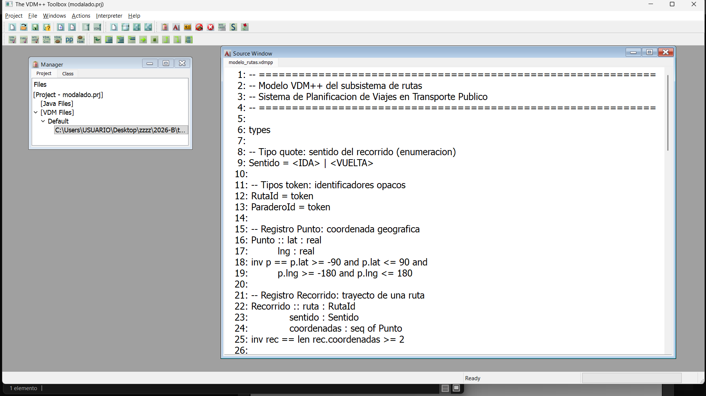
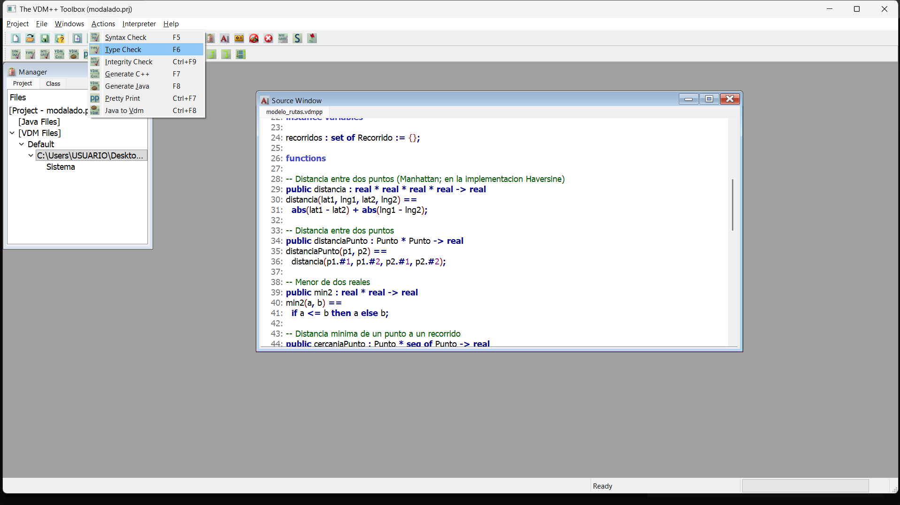
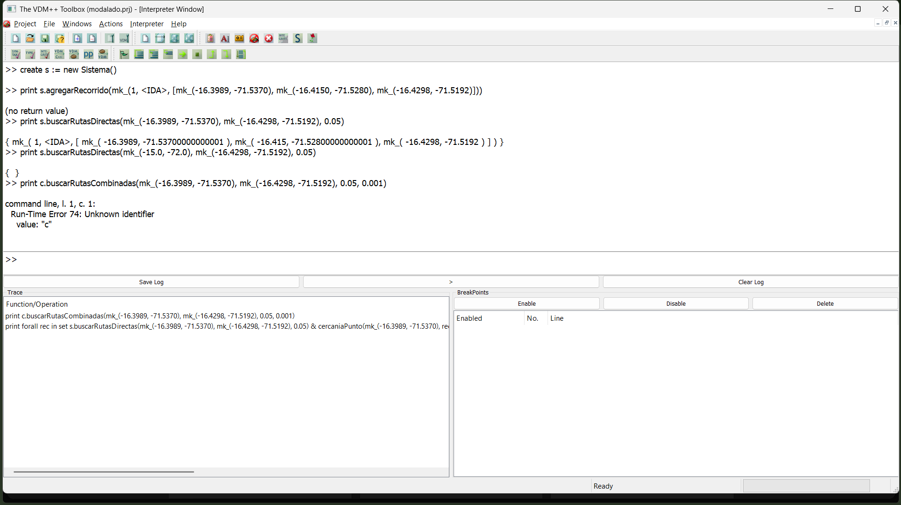
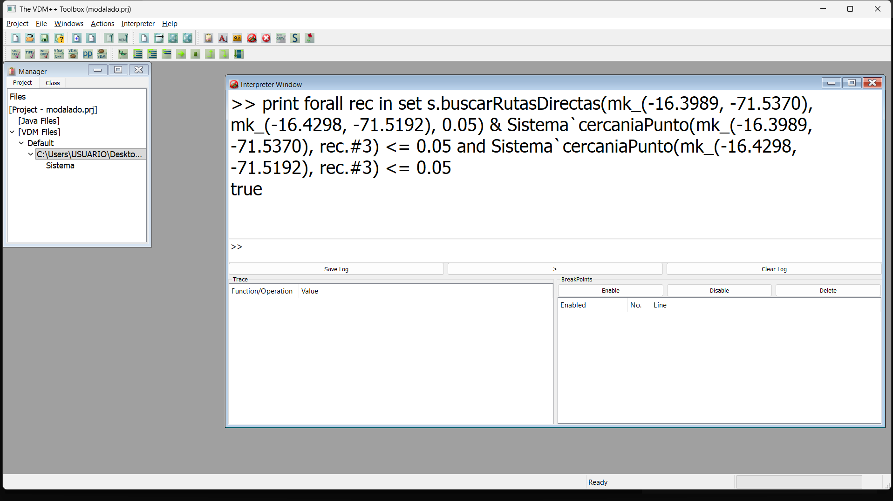
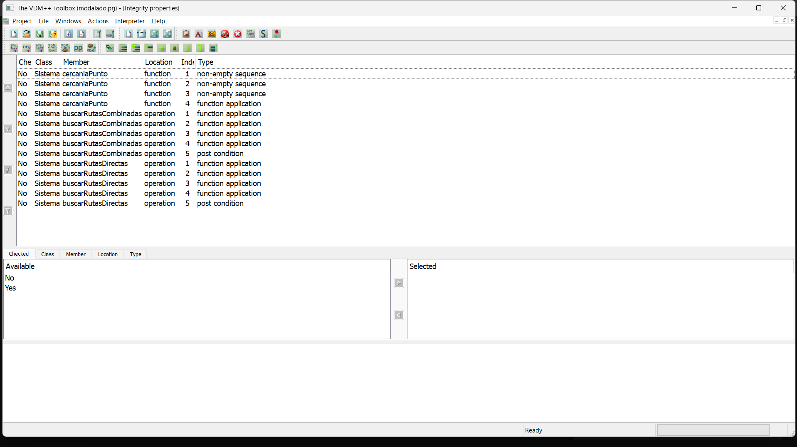

# Sistema de Planificación de Viajes en Transporte Público con Validación Formal en VDM++ para la Ciudad de Arequipa

**Integrantes:** Alvarez Choque Miguel Angel, Cuno Salazar Eduardo Joel, Cruz Gallegos Jeremy Jeison, Inca Moncca Jherson David, Quispe Madariaga Jeferson Jofre

**Universidad Nacional de San Agustín, Arequipa, Perú.**

## Resumen

La información sobre las rutas de transporte público en Arequipa es dispersa e imprecisa, lo que provoca desplazamientos ineficientes y decisiones de movilidad erróneas. Este trabajo propone una plataforma web para la búsqueda de rutas directas y combinadas, cuya componente crítica, el algoritmo de planificación de viajes, es especificada y validada formalmente con el lenguaje VDM++. Se definen los tipos de datos e invariantes del dominio de rutas y se especifican las operaciones de búsqueda mediante pre y postcondiciones que garantizan propiedades como la distancia máxima de acceso a las rutas y la viabilidad de los transbordos. La propuesta se valida mediante la herramienta VDM++ Toolbox, abordando así tanto la correctitud del algoritmo como la escalabilidad de la solución.

**Palabras clave:** métodos formales · VDM++ · transporte público · planificación de rutas · sistemas críticos

## 1. Introducción

### 1.1 Definición del Problema

En la ciudad de Arequipa, la información sobre las rutas del transporte público es dispersa, está desactualizada y no se encuentra disponible de forma clara para el ciudadano. Ante la necesidad de desplazarse entre dos puntos, el usuario desconoce qué línea de bus tomar, cuáles son sus paraderos y si es necesario realizar un transbordo. Esta falta de información confiable produce pérdida de tiempo, desplazamientos innecesarios y decisiones de movilidad incorrectas.

La planificación de viajes en transporte público constituye una tarea computacionalmente *crítica*: un resultado erróneo (una ruta que no pasa cerca del origen, un transbordo inviable o una dirección de recorrido incorrecta) induce al usuario a tomar una decisión equivocada, con el consiguiente costo en tiempo y seguridad. Por este motivo, la correctitud del algoritmo de búsqueda de rutas no puede garantizarse únicamente mediante pruebas de ejecución; se requiere una especificación formal que demuestre propiedades sobre el resultado producido, tal como se argumenta para los sistemas de implementación crítica (Verhoef, 2005).

El presente trabajo propone una plataforma web para la búsqueda de rutas de transporte en Arequipa. Su componente crítica, el algoritmo de búsqueda de rutas directas y combinadas, es especificada y validada formalmente mediante el lenguaje VDM++ (Fitzgerald et al., 2008), utilizando invariantes, precondiciones y postcondiciones. La validación del modelo se realiza con la herramienta VDMTools (Fitzgerald et al., 2008).

### 1.2 Objetivos

**Objetivo general**

Desarrollar una propuesta de solución para la planificación de viajes en transporte público, cuya componente crítica, el algoritmo de búsqueda de rutas, sea especificada y validada formalmente con VDM++, garantizando su correctitud y escalabilidad.

**Objetivos específicos**

1. Definir los tipos de datos e invariantes del dominio de rutas (recorridos, paraderos y radios de búsqueda).
2. Especificar en VDM++ las operaciones de búsqueda de rutas directas y de rutas combinadas mediante pre y postcondiciones.
3. Establecer las propiedades que el algoritmo debe garantizar, tales como la distancia máxima de acceso a una ruta, la viabilidad de los transbordos y la longitud mínima de los segmentos.
4. Validar el modelo formal con la herramienta VDM++ Toolbox mediante obligaciones de prueba y casos de prueba.
5. Documentar los requerimientos funcionales y los trabajos relacionados que sustentan la propuesta.

## 2. Trabajos Relacionados

La presente propuesta se fundamenta en la línea de investigación de la especificación formal con VDM++ y su aplicación a sistemas de implementación crítica y de gran escala.

Respecto al soporte de herramientas, Fitzgerald, Larsen y Sahara (Fitzgerald et al., 2008) describen VDMTools, un conjunto de herramientas que analizan modelos expresados en VDM y sus dialectos VDM++ y VDM-RT, y que ofrecen verificación estática, generación automática de código, mapeo a UML, análisis de cobertura de pruebas y depuración. Este trabajo destaca que VDMTools está orientado al desarrollo rentable de modelos formales en entornos industriales, lo que sustenta la elección de esta herramienta para validar el algoritmo propuesto.

En el ámbito de los sistemas críticos, Verhoef, Larsen y Hooman (Verhoef et al., 2006) extienden VDM++ para modelar y validar sistemas embebidos distribuidos en tiempo real, definiendo una semántica operacional constructiva validada con VDMTools. De forma complementaria, Verhoef (2005) analiza el uso de VDM++ para especificar sistemas de tiempo real, argumentando que los métodos formales deben integrarse a los flujos de trabajo industriales y permitir el análisis temprano de propiedades. Ambos trabajos justifican la aplicación de VDM++ a un componente cuya correctitud es crítica, como el algoritmo de planificación de viajes propuesto.

Finalmente, Mochio y Araki (2011) vinculan VDM++ con el desarrollo formal ágil y escalable de software de misión crítica, incluyendo la descripción de arquitecturas y la verificación de especificaciones. Este enfoque respalda el requisito de escalabilidad de la solución, en la medida en que el modelo formal puede acompañar la evolución del sistema.

A diferencia de los trabajos citados, centrados en sistemas de tiempo real o en la infraestructura de herramientas, esta propuesta aplica VDM++ a la verificación de un algoritmo de planificación de rutas de transporte público, en el contexto específico de la ciudad de Arequipa.

## 3. Requerimientos Funcionales

La propuesta plantea una plataforma web con dos funcionalidades principales: la búsqueda de rutas de transporte y el reporte colaborativo de incidencias urbanas. Los requerimientos funcionales que se describen a continuación constituyen la base de la especificación formal; los requerimientos RF1 y RF2 son los que serán especificados y verificados con VDM++.

| ID | Requerimiento funcional |
|----|-------------------------|
| RF1 | Búsqueda de rutas directas: para un origen y un destino dados, el sistema debe devolver las rutas cuyo recorrido pase a una distancia menor o igual a un radio definido (1000 m) de ambos puntos. |
| RF2 | Búsqueda de rutas combinadas: el sistema debe devolver combinaciones de dos rutas con un punto de transbordo viable, respetando una distancia máxima de transbordo (100 m) y una longitud mínima de segmento (500 m). |
| RF3 | Visualización en mapa: el sistema debe mostrar en un mapa interactivo el recorrido de las rutas y sus paraderos. |
| RF4 | Estimación de distancia y tiempo: el sistema debe calcular la distancia total del viaje y un tiempo estimado, incluyendo el tiempo de transbordo. |
| RF5 | Gestión de datos de rutas: el sistema debe permitir cargar rutas desde archivos KML y asociar los paraderos cercanos a cada recorrido. |

## 4. Modelo en VDM++

El componente crítico del sistema, el algoritmo de búsqueda de rutas, se especificó como una clase VDM++ denominada `Sistema`. El modelo se organiza en tipos, una variable de instancia, funciones auxiliares y operaciones con pre y postcondiciones.



### 4.1 Tipos e invariantes

El modelo define el tipo *quote* `Sentido` (ida o vuelta), el identificador de ruta `RutaId`, y los tipos compuestos `Punto` (coordenada geográfica) y `Recorrido` (ruta, sentido y secuencia de puntos):

```
class Sistema
types
  public Sentido   = <IDA> | <VUELTA>;
  public RutaId    = nat;
  public Punto     = real * real;
  public Recorrido = RutaId * Sentido * seq of Punto;

instance variables
  recorridos : set of Recorrido := {};
```

El dominio impone dos invariantes: (i) todo punto debe tener coordenadas dentro del rango geográfico válido (−90° ≤ lat ≤ 90° y −180° ≤ lng ≤ 180°); y (ii) todo recorrido debe tener al menos dos puntos, pues un trayecto requiere origen y destino.

### 4.2 Operaciones y postcondiciones

`buscarRutasDirectas` (RF1) devuelve los recorridos que pasan a una distancia menor o igual a `radio` del origen `A` y del destino `B`:

```
public buscarRutasDirectas : Punto * Punto * real ==> set of Recorrido
buscarRutasDirectas(A, B, radio) ==
  return { rec | rec in set recorridos &
       cercaniaPunto(A, rec.#3) <= radio and
       cercaniaPunto(B, rec.#3) <= radio }
pre A <> B
post forall rec in set RESULT &
       cercaniaPunto(A, rec.#3) <= radio and
       cercaniaPunto(B, rec.#3) <= radio;
```

La postcondición formaliza la propiedad central: toda ruta devuelta se encuentra a una distancia menor o igual al radio respecto del origen y del destino. `buscarRutasCombinadas` (RF2) extiende la búsqueda a pares de recorridos conectados por un transbordo, exigiendo además que las rutas sean distintas y que exista un punto de transbordo dentro de `radioTransbordo`.

### 4.3 Diagrama de clases

El diagrama de clases del dominio de rutas se documenta en formato PlantUML (una empresa tiene varias rutas; cada ruta tiene uno o dos recorridos; y cada recorrido se asocia con paraderos mediante `RecorridoParadero`):

```plantuml
@startuml
class Empresa { nombre; descripcion }
class Ruta { nombre; codigo }
class Recorrido { sentido; coordenadas }
class Paradero { nombre; latitud; longitud }
class RecorridoParadero { orden; distancia }
Empresa "1" --> "*" Ruta
Ruta "1" --> "1..2" Recorrido
Recorrido "1" --> "*" RecorridoParadero
Paradero "1" --> "*" RecorridoParadero
@enduml
```



## 5. Pruebas

La validación del modelo se realizó ejecutando casos de prueba en el intérprete de la VDM++ Toolbox, usando la Plaza de Armas como origen y el Terminal Terrestre como destino.

| Caso | Entrada | Resultado |
|------|---------|-----------|
| P1 | Origen y destino sobre el recorrido, radio 0.05 | Devuelve la ruta |
| N1 | Origen lejano, radio 0.05 | Conjunto vacío |
| C1 | Dos recorridos con transbordo | Par de rutas |

En el caso positivo, el recorrido contiene puntos exactamente en el origen y el destino, por lo que la distancia mínima es nula. En el caso negativo se usa un origen lejano, de modo que ningún recorrido cumple la restricción y el resultado es el conjunto vacío. En el caso combinado, dos recorridos comparten un punto de transbordo dentro del radio establecido.



## 6. Resultados

La validación se centró en comprobar que las operaciones cumplen sus postcondiciones. Además de ejecutar los casos de prueba, se evaluó directamente la postcondición de `buscarRutasDirectas` sobre el resultado, que devuelve `true`; esto confirma que todos los recorridos devueltos se encuentran dentro del radio respecto del origen y del destino.



Adicionalmente, la Toolbox generó las obligaciones de prueba (*proof obligations*) asociadas a las postcondiciones de las operaciones de búsqueda, que expresan formalmente las propiedades que el modelo debe satisfacer.



## 7. Discusión

Los resultados muestran que la especificación formal captura correctamente las propiedades centrales del algoritmo de búsqueda. Las postcondiciones de `buscarRutasDirectas` y `buscarRutasCombinadas` expresan con precisión las garantías del sistema: proximidad de las rutas al origen y al destino, y viabilidad de los transbordos.

Sin embargo, la validación por interpretación no equivale a una demostración deductiva completa: los casos de prueba cubren escenarios representativos, pero no prueban la postcondición para todas las entradas posibles. Las obligaciones de prueba generadas por la Toolbox constituyen el punto de partida para una verificación más rigurosa.

## 8. Conclusiones

Se especificó y validó formalmente, mediante VDM++, el componente crítico de una plataforma de planificación de viajes en transporte público para Arequipa. El modelo define los tipos del dominio, las operaciones de búsqueda de rutas directas y combinadas, y sus postcondiciones.

La validación en la VDM++ Toolbox permitió comprobar que el modelo es consistente, que las operaciones se ejecutan correctamente sobre casos de prueba representativos y que las postcondiciones se satisfacen.

## 9. Limitaciones

Primero, la función de distancia se modeló de forma simplificada (Manhattan), mientras que la implementación real usa Haversine. Segundo, por compatibilidad con la versión de la herramienta, los tipos registro se representaron como tipos producto (tuplas). Tercero, la validación se basó en interpretación y casos de prueba, no en una demostración deductiva completa. Finalmente, el conjunto de datos de prueba es reducido.

## 10. Recomendaciones y Trabajos Futuros

Como trabajo futuro se propone: (i) incorporar la fórmula de Haversine en el modelo; (ii) completar la verificación demostrando formalmente las obligaciones de prueba; (iii) ampliar el modelo con cálculo de tiempo estimado y ordenamiento de resultados; (iv) integrar el modelo formal con la implementación web (Django y React); y (v) ampliar los casos de prueba con datos reales de las rutas de Arequipa.

## Referencias

1. J. S. Fitzgerald, P. G. Larsen y S. Sahara, "VDMTools: Advances in Support for Formal Modeling in VDM", *ACM SIGPLAN Notices*, vol. 43, n.º 2, pp. 3–11, 2008.
2. M. Verhoef, P. G. Larsen y J. Hooman, "Modeling and Validating Distributed Embedded Real-Time Systems with VDM++", en *FM 2006: Formal Methods*, LNCS 4085, Springer, 2006, pp. 147–162.
3. M. Verhoef, "On the Use of VDM++ for Specifying Real-time Systems", Informe técnico ICIS-R05033, Radboud University Nijmegen, 2005.
4. H. Mochio y K. Araki, "VDM++ as a Basis of Scalable Agile Formal Software Development", en *Proceedings of the 9th Overture Workshop*, 2011, pp. 50–58.
