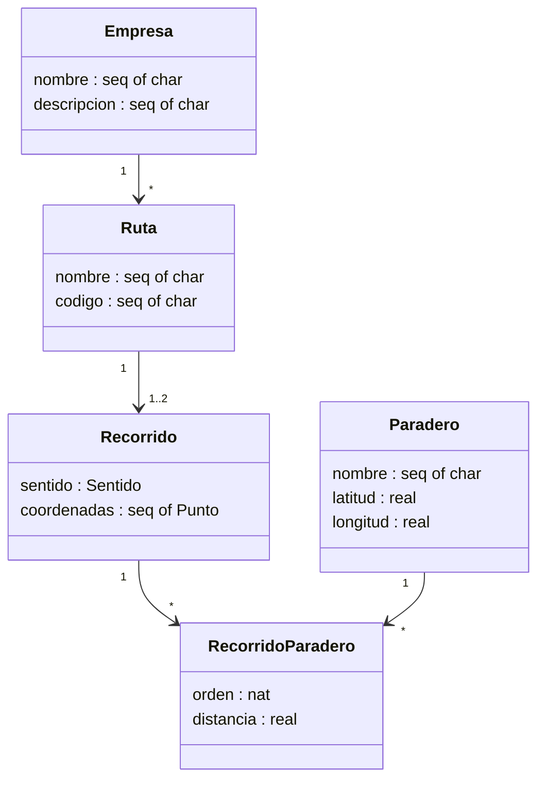

# Modelado en VDM++ de los Componentes del Subsistema de Rutas

**Proyecto:** Sistema de Planificación de Viajes en Transporte Público

## Resumen

Este documento presenta el modelado inicial en VDM++ del subsistema de rutas del proyecto de planificación de viajes en transporte público. Se identifican los tipos *quote* y *token*, se modela un registro con una invariante, se analiza el uso de los tipos secuencia (`seq`) y conjunto (`set`), se propone un diagrama de clases inicial y se utiliza el tipo `map` para relacionar dichas clases, indicando la invariante asociada.

---

## 1. Tipos Quote y Token

Un tipo **quote** representa un conjunto finito de valores simbólicos (una enumeración). En el subsistema de rutas, el campo `sentido` del recorrido solo admite dos valores, por lo que se modela como un tipo quote:

```
Sentido = <IDA> | <VUELTA>
```

Un tipo **token** representa valores opacos que no admiten ninguna operación, salvo la igualdad; se usa para identificadores únicos cuyo contenido interno no es relevante para la especificación:

```
RutaId     = token
ParaderoId = token
```

---

## 2. Registro modelado con invariante

Un **registro** (*record*) es un tipo compuesto por campos con nombre. Se modelan dos registros: `Punto`, que representa una coordenada geográfica, y `Recorrido`, que agrupa los datos de un trayecto.

```
Punto :: lat : real
         lng : real;

Recorrido :: ruta         : RutaId
             sentido      : Sentido
             coordenadas  : seq of Punto
             color        : seq of char;
```

Se definen dos **invariantes**. La primera garantiza que las coordenadas estén dentro de un rango geográfico válido; la segunda, que todo recorrido tenga al menos dos puntos, coincidiendo con la regla de negocio del sistema.

```
inv punto ==
  lat >= -90  and lat <= 90  and
  lng >= -180 and lng <= 180;

inv recorrido ==
  len coordenadas >= 2;
```

---

## 3. Uso de Secuencia (Seq) y Conjunto (Set)

El proyecto hace uso de **ambos** tipos: secuencia y conjunto.

- **Secuencia (`seq`)**: el campo `coordenadas : seq of Punto`. Modela la propiedad de *orden* del trayecto: el orden de los puntos define el recorrido y es posible que un punto se repita (por ejemplo, en una parada). Por ello se elige secuencia y no conjunto.
- **Conjunto (`set`)**: colecciones como `paraderos : set of ParaderoId` o `empresas : set of Empresa`. Modelan catálogos en los que el *orden no importa* y *no debe haber duplicados*, por lo que el conjunto es la representación natural.

---

## 4. Diagrama de clases inicial

El diagrama incluye las clases `Empresa`, `Ruta`, `Recorrido`, `Paradero` y `RecorridoParadero`, junto con sus asociaciones y cardinalidades.



---

## 5. Tipo MAP para relacionar las clases

El tipo `map` relaciona un dominio con un rango. Para vincular cada ruta con sus recorridos se define:

```
recorridosPorRuta : map Ruta to set of Recorrido
```

---

## 6. Invariante asociada

La **invariante asociada** establece dos propiedades: (1) cada ruta tiene a lo sumo dos recorridos (IDA y VUELTA), y (2) cada recorrido almacenado en el mapa hace referencia a la ruta que lo contiene.

```
inv recorridosPorRuta ==
  (forall r in set dom recorridosPorRuta &
     card recorridosPorRuta(r) <= 2)
  and
  (forall r in set dom recorridosPorRuta &
     forall rec in set recorridosPorRuta(r) &
       rec.ruta = r);
```
